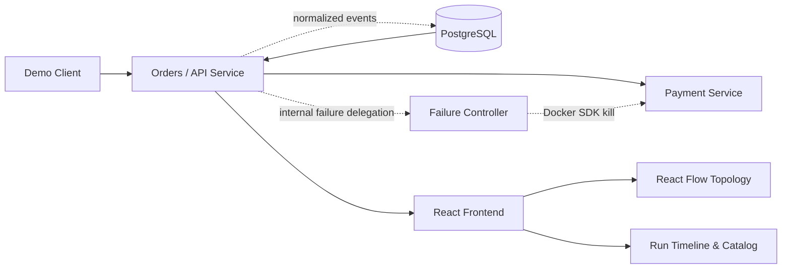

# CHRONOS — Project Context, Architecture, Roadmap, and Decision Ledger

> **Living project brief.** Read this before making architectural changes or continuing work after a context reset.
>
> **Current target:** MVP demo/release during **November 15–21, 2026**.
>
> **Last updated:** November 9, 2026 — Complete Project Context Reconciliation through Milestone 2, Cognito Auth, Failure Controller Security Redesign, AWS Deployment Preflight, and Engineering Handoff.
>
> **Repository:** `git@github.com:sirbasil/chronos.git` (branch: `main`, remote: `origin`).
>
> **Important:** This document was reconstructed from retained project notes, export summaries, and engineering handoff reports after the primary CHRONOS conversation was deleted. It is detailed and evidence-based, but it cannot reproduce discussions that existed only in the deleted conversation and were not retained elsewhere. Items are classified with explicit statuses (**Confirmed decision**, **Implemented and verified**, **Implemented; verification pending**, **Historically verified**, **Planned**, **Proposed**, **Deferred**, **Open issue / risk**, or **Unknown**) to avoid confusing intentions with implementation.

---

## 1. Executive summary

**CHRONOS is a small, instrumented distributed-system observability and controlled failure-experiment platform.** It runs a deliberately simple multi-service application, records normalized events from a run, stores those events, exposes the observed service topology, lets the developer intentionally cause a controlled failure, and provides an event timeline for investigating what happened.

The central story is:

> **CHRONOS watches a system, lets you break it in a controlled way, records what happened, and lets you inspect—or visually play back—the recorded run.**

This is not meant to become a production-scale observability product before the semester MVP. It is a focused systems-engineering project that demonstrates API design, networked services, event schemas, persistence, observability, failure handling, testing, and a useful developer-facing visualization.

### MVP in one sentence

Run a tiny Docker Compose system—**client → API → Orders → Payment**—capture a normalized event stream with a shared `run_id` and relevant `trace_id`, persist events and run metadata in PostgreSQL, expose the run's topology over REST, inject a controlled container-kill failure, and inspect the resulting timeline through a minimal interface.

### What CHRONOS is not (for the MVP)

- **Not a replacement for a full production observability stack.**
- **Not Kubernetes orchestration software.**
- **Not a general-purpose chaos-engineering scheduler or fault-injection framework.**
- **Not a distributed execution engine.**
- **Not deterministic re-execution of all service calls.**
- **Not restoration or reconstruction of application/database state from a timeline.**
- **Not an automated root-cause oracle.** It records and exposes evidence so a person can reason about a failure.

The word **replay** in the MVP means **play back recorded events/timeline data**. It does **not** mean re-running the original distributed computation or rebuilding the exact prior state.

---

## 2. The problem CHRONOS is intended to solve

When several services call each other, a single user request can cross multiple process boundaries. If one service fails, it can be difficult to determine:

- which services were involved in a particular run;
- the order in which requests, calls, responses, and errors occurred;
- where an error began and which downstream work was affected;
- what changed when a failure was deliberately introduced;
- whether the same experiment can be run and inspected again.

CHRONOS narrows this problem into an observable, repeatable local experiment. It gives each run an identity, normalizes events into one schema, persists them, and exposes both a service-topology view and a chronological event view.

### Target users / scenario

The primary user is the developer or student investigating a small distributed system locally. The showcase scenario should be understandable to someone who has not seen the source code: start a run, observe the service path, stop one service, and see the consequences reflected in the recorded events.

### Main value proposition

CHRONOS is valuable when it demonstrates all three outcomes:

1. **Observability:** the system captures enough structured evidence to understand a run.
2. **Causal experiment:** a controlled failure can be introduced and its effects recorded.
3. **Replayable record:** a run can be browsed afterward in a stable event sequence.

The original roadmap calls these milestones **A: Observable system**, **B: Causal experiment**, and **C: Replayable run**.

---

## 3. Scope and variant strategy

The retained roadmap explicitly names a semester/frozen-stack build and a deferred **“Mid” variant**. It does **not** contain a fully agreed, detailed specification for a separate “Full” variant. The following table preserves that distinction.

### Variant A — Semester MVP / frozen-stack variant (**current plan**)

**Purpose:** deliver a complete, understandable project by the November 15–21, 2026 target without expanding the technology surface unnecessarily.

**Stack:** Python, FastAPI, PostgreSQL, Docker Compose, React, TypeScript, Tailwind CSS, React Flow, and pytest. Start event capture with simple request middleware and a normalized event contract. OpenTelemetry can be added later as a capture adapter if the core implementation is stable and time allows.

**Scope:**

- Local client → API → Orders → Payment service path.
- Normalized event generation.
- `run_id` and request/trace correlation where available.
- Persist event records plus minimal run metadata in PostgreSQL.
- Retrieve a run's event timeline.
- REST topology endpoint, explicitly planned as `GET /runs/{id}/topology`.
- Topology displayed with React Flow (`@xyflow/react`).
- Failure injection by killing one explicitly selected local Docker container via Docker API.
- Record the injected failure and observed consequences.
- Timeline view; play/pause/step playback is desirable, but a static timeline is the agreed fallback if schedule or reliability becomes a problem.
- Tests written alongside every slice, not postponed to the end.

**Explicitly excluded from this variant:** Kafka, Kubernetes, WebSockets, network partition simulation, full deterministic replay, state reconstruction, and premature multi-language rewrites.

### Variant B — “Mid” variant (**deferred; only after the current project gate/GATE period**)

The surviving roadmap explicitly says **Go, NATS, Redis, Jaeger, and Toxiproxy (the “Mid” variant) start only after GATE**. This is not part of the November MVP.

Possible roles are described below as *candidate uses*, not commitments to add every component:

| Technology | Possible future role | Why it is deferred |
|---|---|---|
| Go | Implement one service or a selected subsystem to explore concurrency and systems programming | A rewrite now creates risk and does not help deliver the MVP. Do not rewrite all of CHRONOS in Go. |
| NATS | Introduce a message bus for event or service communication if the simple request-based design reaches a real limitation | The MVP does not need a broker to show a working service path. |
| Redis | Add ephemeral state, caching, or coordination only if a demonstrated requirement calls for it | PostgreSQL is the planned durable event store; don't add a second datastore without a defined purpose. |
| Jaeger | Visualize distributed traces when OpenTelemetry instrumentation/export is integrated | The MVP first needs its own clear normalized event model and useful local views. |
| Toxiproxy | Simulate latency, connection loss, or other network faults beyond stopping a container | The MVP's initial failure experiment is deliberately limited to killing a selected container. |
| OpenTelemetry | Provide a standard instrumentation/capture adapter and potentially export trace context | It is planned as a later adapter, not a reason to skip learning the event contract. |

Adding one of these technologies must be justified by a use case, learning goal, and test. The Mid variant is an expansion path, not a checklist.

### Variant C — Expanded / research direction (**not yet formally specified**)

Potential directions implied by the project idea include richer network-failure experiments, broader trace integration, longer-term performance measurements, or higher-fidelity replay research. These are **idea-space only**; the surviving notes do not define a committed “Full variant.”

Before pursuing this variant, first deliver and document the semester MVP. Potential future work must specify a real gap, a success metric, and the scope it replaces or extends. A visual event playback feature must not be marketed as deterministic distributed execution replay.

### Scope decision rule

When time is short, cut in this order:

1. Cut play/pause/step playback down to a static event timeline.
2. Defer optional OpenTelemetry or third-party observability integrations.
3. Defer all Mid-variant tools.
4. Defer every feature not needed to show the service path, stored events, topology, and one controlled failure experiment.

Do **not** cut the end-to-end demo, the event contract, basic tests, or documentation of how to run the project.

---

## 4. Confirmed architecture and boundaries

### The demo service path



This is a **logical and operational** diagram. The exact process/deployment boundary between the application API, event collector, and CHRONOS API has been consolidated: the FastAPI Orders service handles both the business checkout endpoint and the CHRONOS observability/run endpoints.

### Component responsibilities

| Component | Responsibility | Current Implementation Status |
|---|---|---|
| Demo client / Frontend | Initiates user requests, creates runs, triggers checkouts, and visualizes runs | Implemented & Verified in React + Vite (`frontend/`) |
| Orders service | Accepts requests, coordinates downstream calls to Payment, records normalized events, and serves CHRONOS REST endpoints | Implemented & Verified in FastAPI (`backend/server_fastapi.py`) |
| Payment service | Downstream dependency responding with approvals; target of controlled failure injection | Implemented & Verified in FastAPI (`backend/payment_service.py`) |
| Failure Controller | Isolated internal microservice with Docker daemon access; kills payment container upon authenticated request | Implemented & Verified in FastAPI (`backend/failure_controller/`) |
| PostgreSQL | Durable store for normalized events and run lifecycle metadata | Implemented & Verified in PostgreSQL 16 Alpine (`01-http-basics-postgres-1`) |
| React UI | Illuminated retro-futuristic cockpit console for telemetry, run catalog, and interactive topology | Implemented & Verified in React 18 + `@xyflow/react` (`frontend/src/`) |
| Docker Compose | Multi-container local orchestration wiring services, networks, and named volumes | Implemented & Verified (`backend/docker-compose.yml`, `docker-compose.failure-injection.yml`) |

### Control plane vs. demo application

1. **The sample system under observation:** Orders and Payment.
2. **The CHRONOS control/inspection function:** event collection, run metadata, storage, topology/timeline APIs, failure controller, and the frontend cockpit UI.

The FastAPI Orders service acts as the combined host for the sample application and the CHRONOS observability API. The Payment service and PostgreSQL database run in isolated containers. The Failure Controller runs as an isolated internal microservice with strict network boundaries.

### Current repository structure

The repository has been consolidated from historical learning slices into a top-level production structure:

```text
chronos/
├── CHRONOS_CONTEXT.md                     # Living project brief, architecture & decision ledger
├── amplify.yml                            # AWS Amplify frontend build specification
├── deploy/
│   └── Caddyfile                          # Production reverse proxy configuration
├── docs/
│   ├── AWS_COGNITO_SETUP.md               # Cognito setup runbook, JWT architecture & deployment checklist
│   └── AWS_DEPLOYMENT.md                  # Comprehensive EC2 and Amplify deployment guide
├── backend/
│   ├── Dockerfile.orders                  # Orders service container build
│   ├── Dockerfile.payment                 # Payment service container build
│   ├── docker-compose.yml                 # Base Compose stack (orders, payment, postgres, failure-controller)
│   ├── docker-compose.failure-injection.yml # Override enabling failure injection
│   ├── requirements.txt                   # Backend dependencies (fastapi, uvicorn, psycopg, pyjwt, requests)
│   ├── server_fastapi.py                  # Primary FastAPI API server & route handlers
│   ├── payment_service.py                 # Payment service implementation
│   ├── auth.py                            # Cognito JWT validation, JWKS caching & RBAC dependencies
│   ├── database.py                        # PostgreSQL persistence layer with psycopg dict_row
│   ├── event_schema.py                    # Normalized ChronosEvent Pydantic schema
│   ├── failure_injector.py                # Orders failure delegation client & event persistence
│   ├── failure_controller/                # Isolated Failure Controller microservice
│   │   ├── Dockerfile                     # Non-root chronos:1001 container build
│   │   ├── main.py                        # Restricted payment container kill API
│   │   └── requirements.txt               # Minimal dependencies (fastapi, uvicorn, docker)
│   ├── deploy/
│   │   └── compose.prod.yml               # Sanitized production Compose configuration
│   └── tests/                             # Comprehensive pytest test suite (106 tests)
└── frontend/
    ├── README.md                          # Frontend documentation
    ├── package.json                       # Dependencies (@xyflow/react, aws-amplify, tailwindcss, lucide-react)
    ├── vite.config.ts                     # Vite build configuration
    ├── tailwind.config.js                 # Retro-futuristic theme configuration
    ├── src/
    │   ├── App.tsx                        # Cockpit main layout & auth gate
    │   ├── auth/                          # AWS Amplify v6 config & AuthContext state machine
    │   ├── components/                    # Header, Navigation, Inspector, StatusStrip
    │   ├── components/views/              # RunsView (catalog & run creation), TopologyView (React Flow)
    │   ├── components/monitor/            # MetricsCluster, MonitorView, ServiceMatrix, TraceInstrument
    │   ├── services/chronosApi.ts         # Central typed REST API client with Bearer token injection
    │   └── types/                         # TypeScript interfaces (api.ts, events.ts, ui.ts)
    └── src-tauri/                         # Tauri 2 native desktop configuration and assets
```

---

## 5. Technology stack and learning principles

### Semester stack

| Area | Technology | Status in CHRONOS |
|---|---|---|
| Main language | Python 3.14 | **Implemented & Verified** |
| Backend API | FastAPI | **Implemented & Verified** |
| ASGI Server | Uvicorn | **Implemented & Verified** |
| Database | PostgreSQL 16 Alpine | **Implemented & Verified** |
| Local environment | Docker Compose 5.6.1 | **Implemented & Verified** |
| Frontend framework | React 18 | **Implemented & Verified** |
| Language for frontend | TypeScript 5.6 | **Implemented & Verified** |
| Styling | Tailwind CSS 3.4 | **Implemented & Verified** |
| Topology visualization | React Flow (`@xyflow/react` 12.3) | **Implemented & Verified** |
| Backend testing | pytest 9.2 (106 tests) | **Implemented & Verified** |
| Authentication | Amazon Cognito User Pool (`ap-south-1`) | **Implemented & Verified** |
| Frontend Auth SDK | AWS Amplify v6 (`aws-amplify@6.22.2`) | **Implemented & Verified** |
| Desktop shell | Tauri 2 | **Configured (M1.5); Standalone release pending** |
| OpenTelemetry | OTel capture adapter | **Deferred to post-MVP** |

### User's learning preference

The user explicitly wants to **write the code themselves and understand the implementation**, rather than receiving complete copy-paste code dumps. This principle remains paramount throughout development.

The preferred teaching loop:

1. **Explain the concept** and why CHRONOS needs it.
2. **Give one small implementation task**—not the full answer.
3. **Let the user attempt it.**
4. **Review the code and reasoning.**
5. **Provide focused hints** before offering fuller solutions.
6. **Debug actual errors** and explain their root cause.
7. **Test the result** and connect it to the next implementation step.

Be blunt, realistic, and practical. Prioritize the MVP delivery rather than introducing unnecessary technologies for popularity.

---

## 6. Canonical event model

The normalized event schema is a foundational contract. Every downstream component (database, API, topology, timeline, and future adapters) consumes the exact same normalized event structure.

### Canonical fields

| Field | Type | Purpose | Notes |
|---|---|---|---|
| `event_id` | `UUID` | Unique event identifier | Automatically generated (`uuid4`) |
| `run_id` | `UUID` | Groups events belonging to one run/experiment | Mandatory correlation key across all services |
| `timestamp` | `datetime` | UTC timestamp of event occurrence | Defaults to `datetime.now(timezone.utc)` |
| `service_id` | `str` | Stable name of the emitting service | E.g. `orders`, `payment` |
| `trace_id` | `str \| None` | Correlates events within an end-to-end request trace | Propagated across HTTP calls; optional |
| `event_type` | `str` | Normalized semantic classification | Restricted literal vocabulary (see below) |
| `source` | `str` | Capture origin / middleware identifier | E.g. `orders-api`, `chronos-control` |
| `payload` | `dict[str, Any]` | Structured event-specific payload | JSONB in PostgreSQL; secrets strictly prohibited |
| `severity` | `str` | Importance level | Restricted to `INFO`, `WARNING`, `ERROR` |

### Known event types

```text
REQUEST_START       # Incoming request accepted by a service
REQUEST_END         # Request completed / returned by a service
SERVICE_CALL        # Outgoing inter-service request initiated
SERVICE_ERROR       # Downstream call failed (timeout, network, HTTP error)
RESPONSE            # Downstream call returned successfully
FAILURE_INJECTED    # Controlled fault injected by Failure Controller
```

### Event model requirements

- Every event in an experiment must share the exact same `run_id`.
- Inter-service requests propagate correlation IDs.
- Chronological ordering is preserved via timestamp index and database primary keys.
- Event payloads contain structured details (e.g. `order_id`, `destination_service`, `error_type`, `container_id`, `target`).
- Database serialization and API JSON serialization match the Pydantic model contract.

---

## 7. Run lifecycle and persistence

### Run lifecycle states

```text
IN_PROGRESS ──> COMPLETED (Normal checkout)
      │
      └───────> FAILED    (Failure-affected checkout)
```

1. **Run Creation (`POST /runs`):**
   - Generates a server-side UUID via `uuid4()`.
   - Records run start timestamp in UTC.
   - Sets initial status to `IN_PROGRESS`.
   - Returns `HTTP 201 Created` with `run_id`, `started_at`, and `status`.

2. **Checkout Request (`POST /orders/{order_id}/checkout`):**
   - Supports optional `X-Run-ID` header.
   - If `X-Run-ID` is provided:
     - Validates that the run exists (returns 404 if missing).
     - Validates that the run status is `IN_PROGRESS` (returns 409 if completed or failed).
     - Adopts the specified `run_id` for all events generated during checkout.
   - If `X-Run-ID` is omitted:
     - Automatically generates a new `run_id` and creates an `IN_PROGRESS` run to maintain backward compatibility.

3. **Normal Run Event Sequence (4 events):**
   ```text
   1. REQUEST_START   (orders, INFO)
   2. SERVICE_CALL    (orders -> payment, INFO)
   3. RESPONSE        (orders, INFO, payment status approved)
   4. REQUEST_END     (orders, INFO)
   --> Run status updated to COMPLETED
   ```

4. **Failure-Affected Run Event Sequence (5 events):**
   ```text
   1. FAILURE_INJECTED (orders, WARNING, target=payment, action=kill)
   2. REQUEST_START    (orders, INFO)
   3. SERVICE_CALL     (orders -> payment, INFO)
   4. SERVICE_ERROR    (orders, ERROR, error_type=ConnectionError/Timeout)
   5. REQUEST_END      (orders, ERROR)
   --> Run status updated to FAILED
   ```

### PostgreSQL persistence

PostgreSQL 16 Alpine persists run metadata and events:

- `runs` table: `run_id` (UUID PK), `started_at` (TIMESTAMPTZ), `completed_at` (TIMESTAMPTZ), `status` (VARCHAR).
- `events` table: `event_id` (UUID PK), `run_id` (UUID FK -> runs ON DELETE CASCADE), `timestamp` (TIMESTAMPTZ), `service_id`, `trace_id`, `event_type`, `source`, `payload` (JSONB), `severity`.
- Indexes: `idx_events_run_id`, `idx_events_timestamp`, `idx_events_run_id_timestamp`.
- Persistent named volume: `01-http-basics_postgres_data`.
- Historical database volume verification (November 9, 2026): **1,809 runs** and **3,176 events** verified intact. Zero data loss.

---

## 8. REST API contract & route authorization matrix

All endpoints enforce authentication and authorization via FastAPI dependencies in `backend/server_fastapi.py`:

| Method | Route | Authorization Level | Enforcement Mechanism | Purpose |
|---|---|---|---|---|
| `GET` | `/` | **Public** | None | Root landing & service health check |
| `GET` | `/health` | **Public** | None | Database connection probe & health status |
| `GET` | `/orders` | **Authenticated** | `Depends(get_current_user)` | Orders service index |
| `GET` | `/orders/{order_id}` | **Authenticated** | `Depends(get_current_user)` | Fetch individual order details |
| `POST` | `/orders/{order_id}/checkout` | **Authenticated** | `Depends(get_current_user)` | Execute checkout with optional `X-Run-ID` |
| `GET` | `/runs` | **Authenticated** | `Depends(get_current_user)` | List recent runs with duration and event counts |
| `POST` | `/runs` | **Authenticated** | `Depends(get_current_user)` | Create a new active `IN_PROGRESS` run |
| `GET` | `/runs/{run_id}` | **Authenticated** | `Depends(get_current_user)` | Retrieve single run metadata |
| `GET` | `/runs/{run_id}/events` | **Authenticated** | `Depends(get_current_user)` | Retrieve chronological event timeline for run |
| `GET` | `/runs/{run_id}/topology` | **Authenticated** | `Depends(get_current_user)` | Retrieve derived service nodes and edges |
| `POST` | `/runs/{run_id}/failure` | **Operator / Admin Only** | `Depends(require_operator_or_admin)` | Inject controlled failure into active run |

---

## 9. Observed service topology

The topology endpoint `GET /runs/{run_id}/topology` derives service architecture dynamically from observed run events:

- **REST-only:** strictly synchronous REST; no WebSockets in the MVP.
- **Node generation:** derived from distinct `service_id` and downstream destination services recorded in `SERVICE_CALL` events.
- **Edge generation:** directed edges (`source` -> `target`) constructed exclusively from recorded `SERVICE_CALL` events.
- **Deduplication:** multiple calls between the same services within a run produce a single directed edge.
- **Payload structure:**
  ```json
  {
    "run_id": "c178e733-58c3-4515-bb11-14df56b1e0ff",
    "nodes": [
      {"id": "orders", "service_id": "orders"},
      {"id": "payment", "service_id": "payment"}
    ],
    "edges": [
      {
        "source": "orders",
        "target": "payment",
        "event_type": "SERVICE_CALL"
      }
    ]
  }
  ```
- **Error behavior:** nonexistent `run_id` returns `HTTP 404 Not Found` with `{"detail": "Run <id> not found"}`.

---

## 10. Failure injection architecture and security redesign

### 10.1 Historical vulnerability (Resolved)

In the initial implementation, `/var/run/docker.sock` was mounted directly into the public-facing `orders` container. Because Orders is an HTTP API accessible to external requests, any application-layer compromise would have granted root-level access to the host Docker daemon.

### 10.2 Security redesign: isolated failure controller

The Docker socket and Docker SDK were completely eliminated from the Orders service and isolated inside a dedicated internal microservice:

```text
                     PUBLIC INTERNET / OPERATOR
                                 │
                                 ▼
                          ORDERS / API
                         FastAPI :8000
                       ├── No Docker SDK
                       └── No Docker socket
                                 │
                                 │ (Internal HTTP POST /internal/failures/payment/kill)
                                 │ (Authenticated via shared secret Bearer token)
                                 ▼
                     01-http-basics-failure-control
                        (Docker network: internal: true)
                                 │
                                 ▼
                         FAILURE CONTROLLER
                         FastAPI :8002
                       ├── Dedicated non-root user (chronos:1001)
                       ├── Mounts /var/run/docker.sock (GID 1001)
                       ├── NO published host ports
                       ├── NO Postgres access or credentials
                       └── Single allowed target: payment container
                                 │
                                 │ (Docker SDK container.kill())
                                 ▼
                           Docker Daemon
                                 │
                                 ▼
                          PAYMENT CONTAINER
```

### 10.3 Network boundaries

- `default` network (`01-http-basics_default`): joined by `orders`, `payment`, and `postgres`.
- `failure-control` network (`01-http-basics-failure-control`): marked `internal: true`. Joined strictly by `orders` and `failure-controller`.
- Payment and PostgreSQL cannot reach the Failure Controller.
- The Failure Controller has zero access to PostgreSQL credentials or user tokens.

### 10.4 Controller hardening specifications

The Failure Controller (`backend/failure_controller/`) implements deep defense:

- Base image: `python:3.14-slim`.
- User: unprivileged user `chronos` (UID 1001, GID 1001).
- Dynamic supplementary group: `group_add: ["${DOCKER_GID}"]` grants access to the root-owned Docker socket without running as root.
- Linux capabilities: all capabilities dropped (`cap_drop: [ALL]`).
- Security options: `no-new-privileges: true`.
- Read-only filesystem: `read_only: true`.
- Temporary directory: `/tmp` mounted as restricted tmpfs (`rw,noexec,nosuid,size=32m`).
- Internal authentication: shared secret `FAILURE_CONTROLLER_TOKEN` validated using constant-time comparison (`hmac.compare_digest`). Missing or invalid credentials return `HTTP 401`.
- Single allowed target: strictly `payment` container under project `01-http-basics`. Attempts to target `orders` or `postgres` return `HTTP 400 Bad Request`.

### 10.5 Internal endpoint specification

- Exact route: `POST /internal/failures/payment/kill` (historical references to `/internal/failures/inject` were proposals superseded by this exact path).
- Flow:
  1. Authenticates internal Bearer token.
  2. Filters containers by `com.docker.compose.project=01-http-basics` and `com.docker.compose.service=payment`.
  3. Verifies exactly one container matches (returns 404 if none, 409 if ambiguous).
  4. Verifies Compose labels match expected values (returns 502 on mismatch).
  5. Reloads container state and verifies it is running (returns 409 if already stopped).
  6. Executes `container.kill()`.
  7. Returns container metadata (`container_id`, `container_name`, `compose_project`, `timestamp`).

### 10.6 Residual security risk

While the attack surface is dramatically reduced, Docker socket access within a container remains effectively equivalent to host-level authority. Protection relies on network isolation, constant-time token comparison, strict target allowlisting, and non-root execution.

---

## 11. Failure experiment and staging integration evidence

A comprehensive staging verification was executed on November 7, 2026, using an isolated staging project (`chronos-staging`):

- **Staging port bindings:** Orders `127.0.0.1:18000`, Payment `127.0.0.1:18001`, PostgreSQL `127.0.0.1:15432`.
- **Controller port:** no published host port (internal only).
- **Baseline test:** Checkout returned `HTTP 200 OK`, payment status `approved`, 4 events recorded, run status `COMPLETED`.
- **Failure injection test:** Payment killed via controller; container transitioned to `Exited (137)`; `FAILURE_INJECTED` persisted; subsequent checkout returned `HTTP 503 Service Unavailable`; 5 events recorded; run status `FAILED`.
- **Recovery test:** Payment container was restarted **manually** via Docker Compose CLI command (`docker compose start payment`); health check became healthy; subsequent checkout returned `HTTP 200 OK`; run completed successfully.
- **Critical recovery distinction:** The staging test demonstrated manual recovery through Docker Compose. **CHRONOS does NOT have an automated or dedicated recovery API endpoint.** Recovery is an operational/Compose action.
- **Safety checks verified:**
  - Missing controller token -> `HTTP 401 Unauthorized`.
  - Invalid controller token -> `HTTP 401 Unauthorized`.
  - Prohibited target -> `HTTP 400 Bad Request`.
  - Repeated injection for same run -> `HTTP 409 Conflict`.
  - Attempting to kill already-stopped target -> `HTTP 409 Conflict`.
- **Teardown:** Staging containers and networks were cleanly removed; the staging database volume was preserved.

---

## 12. Reliability findings and open issues (November 9 audit)

The November 9, 2026 engineering handoff audit identified four critical reliability concerns that must be preserved as open issues:

### 12.1 Failure-event timestamp mismatch

In `backend/failure_injector.py` (line 160), `ChronosEvent` is instantiated without passing a timestamp, falling back to `datetime.now(timezone.utc)`. Although the Failure Controller returns the exact kill timestamp (`controller_result["timestamp"]`), that value is extracted on line 175 but only used in error logging, never assigned to `failure_event.timestamp` or stored in the payload. Consequently, the persisted event reflects Orders-side processing time rather than the exact moment the container was killed.

### 12.2 Missing post-kill state verification

In `backend/failure_controller/main.py` (line 235), `container.kill()` is executed and the controller immediately returns `status: "injected"`. It does not call `container.reload()` or poll to verify that the container transitioned from `running` to `exited`/`stopped`. If process termination takes milliseconds, an immediate status check could report the container as still running.

### 12.3 Non-atomic Docker action and PostgreSQL persistence

The container kill and PostgreSQL event write are separate, non-atomic operations. If the container is killed but PostgreSQL is unreachable or fails during `save_event()`, the payment container is terminated but no `FAILURE_INJECTED` event exists in the database. There is currently no transactional outbox table or background reconciliation worker to recover unpersisted failure events.

### 12.4 Duplicate injection race condition and fail-open pre-check

The duplicate prevention logic in `failure_injector.py` (lines 74-86) queries existing events via `get_events_by_run(run_id)`. Two concurrent requests for the same run can race past this check before either writes to PostgreSQL. Furthermore, if `get_events_by_run()` encounters a database read error, lines 84-85 catch `Exception as pre_err`, log a warning, and proceed, **failing open**.

### 12.5 Historical persistence retries

`failure_injector.py` implements bounded retries for persisting `FAILURE_INJECTED` (3 attempts with exponential backoff: 50ms, 100ms) and logs a `CRITICAL PERSISTENCE FAILURE` before raising `HTTP 500`. While this mitigates transient database hiccups, it does not resolve the fundamental non-atomicity between Docker and PostgreSQL.

---

## 13. Amazon Cognito authentication and authorization

### Backend implementation (`backend/auth.py`)

- **Token verification:** PyJWT with cryptographic RSA validation (`RS256`) against Cognito User Pool JWKS (`ap-south-1_tDVeeHq0g`).
- **JWKS caching:** thread-safe cache with 1-hour TTL and on-demand cache refresh when an unknown `kid` is encountered to handle key rotation.
- **Strict claim verification:** validates `iss` (issuer), `exp` (expiration), `nbf` (not-before), `sub` (subject), and `client_id` (matching `4268fo6vpodgv8dt37tim2aec3`).
- **Access token vs ID token:** strictly requires `token_use == "access"`. ID tokens (`token_use == "id"`) are explicitly rejected with `HTTP 401 Unauthorized`.
- **Role-based access control (RBAC):** reads groups exclusively from `cognito:groups` in verified claims. Protected failure-injection endpoint requires membership in `chronos-admins` or `chronos-operators`.
- **Fail-closed guarantees:**
  - Production (`APP_ENV=production`): application startup halts with `RuntimeError` if Cognito configuration is missing.
  - Development (`APP_ENV=development`): protected endpoints return `HTTP 503 Service Unavailable` if unconfigured.

### Frontend implementation (`frontend/src/auth/`)

- Built with AWS Amplify v6 (`aws-amplify@6.22.2`).
- OAuth flow: Authorization Code Grant with PKCE (`responseType: 'code'`).
- Hosted domain: `chronos-auth-519725697841.auth.ap-south-1.amazoncognito.com`.
- State machine: `LOADING` -> `AUTHENTICATED` | `UNAUTHENTICATED` | `CONFIG_ERROR`.
- API integration: `frontend/src/services/chronosApi.ts` fetches `session.tokens.accessToken` and injects `Authorization: Bearer <accessToken>`.
- UI Cockpit gate: illuminated vintage authentication console in `App.tsx` with `[ INITIATE SECURE SIGN IN ]` and `[ EXPLORE DEMO PREVIEW ]` fallback. Header displays authenticated operator and `[ SIGN OUT ]` control.

### Cognito group chronology discrepancy

| Date | Reported Observation |
|---|---|
| November 7, 2026 | `chronos-admins` and `chronos-operators` reported missing (0 groups in live pool) |
| November 8, 2026 | Both groups reported created and verified; administrator assigned |
| November 9, 2026 | Live group/user verification unavailable due to expired AWS CLI session (`chronos-dev`) |

**Status:** Reported created and verified on November 8; current existence and membership verification pending.

---

## 14. Frontend and Milestone 2 (M2) implementation

Milestone 2 was completed and frozen on November 7, 2026, delivering full live backend telemetry and interactive topology:

### 14.1 Live telemetry and connection handling

- Connects to FastAPI backend (`http://127.0.0.1:8000`).
- Displays live connection status badges (`ONLINE`, `CONNECTING`, `DISCONNECTED`, `ERROR`).
- Polling, request cancellation via `AbortSignal`, and stale-response prevention.

### 14.2 Runs catalog (`frontend/src/components/views/RunsView.tsx`)

- Lists recent runs with status, start time, and duration.
- Filter tabs: `ALL`, `COMPLETED`, `FAILED`, `IN_PROGRESS`.
- One-click loading of any historical run into the live monitor.
- **Run Creation Workflow (Added November 9, 2026, Commit `913d06b`):** visible `[ START NEW RUN ]` control invoking `POST /runs`, displaying loading indicators, handling errors, and automatically selecting the newly created run.

### 14.3 Interactive topology (`frontend/src/components/views/TopologyView.tsx`)

- Directed acyclic graph rendered using React Flow (`@xyflow/react`).
- Custom cockpit-style nodes with service labels, ports, call counts, and error indicators.
- Animated directed edges representing inter-service calls.
- Clicking any node opens its details in the context inspector.

### 14.4 Event timeline and context inspector

- Chronological event timeline with severity color-coding (`INFO` green, `WARNING` amber, `ERROR` red).
- Scrub bar for navigating events with timestamp offsets.
- Context inspector displaying raw JSON payloads, headers, and metadata.

### 14.5 Live and Preview modes

- **LIVE MODE:** streams real telemetry from backend and PostgreSQL.
- **PREVIEW MODE:** loads local demo fixtures (`frontend/src/data/fixtures.ts`) for offline design inspection.
- Clear visual warning badge when in Preview mode; fixture data is never misrepresented as live telemetry.

### 14.6 Honest disconnected state

When FastAPI is unreachable, the UI displays a dedicated disconnected cockpit state with troubleshooting diagnostics, retry controls, and preview fallback. It never synthesizes fake healthy data.

### 14.7 Centralized API client (`frontend/src/services/chronosApi.ts`)

- Centralized typed client for all REST interactions.
- 5000ms request timeout with automatic abort.
- Dynamic Bearer token injection from active Cognito session.

---

## 15. UI visual direction

The frontend implements an uncompromising retro-futuristic digital instrument cluster aesthetic inspired by:

- **1980 Bertone Lamborghini Athon** cockpit geometry and styling.
- **Volvo Tundra** digital instrument-cluster typography and layout.
- Palette: phosphor greens (`#b8ff00`, `#4ade80`), amber warning lamps (`#ff9e00`), CRT grid overlays, monospace telemetry readouts, and vintage hardware toggles.
- This visual identity is established, complete, and frozen. It must not be replaced with generic modern UI kits.

---

## 16. AWS deployment preparation and actual status

A comprehensive read-only audit was conducted on November 8, 2026, in `ap-south-1` under profile `chronos-dev`:

### 16.1 Critical deployment status correction

**The surviving evidence confirms that a CHRONOS AWS production backend was NOT running.** The November 8 audit found:
- Zero running EC2 instances.
- Zero vCPUs utilized.
- Missing EC2 security group, Elastic IP, IAM role, S3 bucket, and Amplify app.
- The AWS architecture is in a **prepared/preflight state**, not an active production deployment.

### 16.2 Proposed AWS architecture

```text
Browser / Client
       │
       ▼
AWS Amplify (React + Vite Frontend)
       │
       │ HTTPS (Ports 80/443)
       ▼
EC2 (t3a.medium, Ubuntu 24.04 LTS, 40GB gp3)
       │
       ├── Caddy (Reverse Proxy & Automatic TLS)
       │      │
       │      ▼ (http://127.0.0.1:8000)
       ├── Orders Service (FastAPI)
       │      │
       │      ├── Payment Service (Internal network only, port 8001 not public)
       │      ├── PostgreSQL 16 (Named volume, port 5432 not public)
       │      └── Failure Controller (Internal network only, port 8002 not public)
       │
       └── AWS Systems Manager (SSM Session Manager — Port 22 SSH closed)
```

### 16.3 Feasibility findings (November 8 audit)

- Instance type: `t3a.medium` supported across `ap-south-1a`, `ap-south-1b`, `ap-south-1c`.
- Quota: 5 vCPUs available, 0 utilized (2 vCPUs required; no quota increase needed).
- AMI: Ubuntu 24.04 LTS (`ami-0fc5120b2d80d4749` / `ami-094adff9b24048c5c`).
- Estimated monthly cost: ~$38.25; ~$139 in AWS promotional credits reported at audit time.

### 16.4 Deployment blockers and open configuration

- Production Cognito callback/logout URLs must be updated to the final AWS Amplify domain.
- Production CORS origin must be configured for the Amplify domain.
- Public domain and DNS/TLS setup via Caddy pending.
- EC2 instance, IAM role (`chronos-ec2-role`), S3 backup bucket, and CloudWatch log groups must be provisioned.
- Production Compose configuration (`backend/deploy/compose.prod.yml`) and `deploy/Caddyfile` are tracked in the repository.

---

## 17. Historical verification ledger

| Date | Milestone / Activity | Automated Tests | Verification Scope & Results |
|---|---|---|---|
| Nov 5, 2026 | Initial failure injection | 49 passed | Container-kill validation, Orders-to-Payment failure cascade |
| Nov 7, 2026 | Milestone 2 (M2) | 58 passed | Live telemetry, React Flow topology, run catalog, CORS |
| Nov 7, 2026 | AWS / Amplify preparation | 66 passed | CORS origin validation, production Tauri origin checks |
| Nov 7, 2026 | Cognito JWT integration | 86 passed | RS256 JWKS verification, ID token rejection, RBAC groups |
| Nov 9, 2026 | Engineering handoff audit | 106 passed | Full backend regression, Failure Controller auth, DB persistence |

### Additional historical verification checks

- **Docker Compose validation:** `docker compose config --services` identified all four services (`postgres`, `payment`, `orders`, `failure-controller`).
- **PostgreSQL data preservation:** 1,809 runs and 3,176 events verified intact in named volume `01-http-basics_postgres_data`.
- **Frontend production builds:** TypeScript compilation (`tsc`) and Vite bundle build passed with 0 errors.
- **Staging integration:** complete baseline, failure injection, and manual recovery workflow verified in `chronos-staging`.

---

## 18. Repository and Git history

- **Repository:** `sirbasil/chronos` (GitHub).
- **Current branch:** `main`.
- **Remote:** `origin` (`git@github.com:sirbasil/chronos.git`).
- **Key historical commits:**
  - `5630f52`: Add PostgreSQL event persistence and request lifecycle tracking.
  - `0877303`: Add run topology API.
  - `e6a9549`: Add controlled Docker failure injection.
  - `571eea0`: Refactor repository into backend and frontend structure.
  - `ad9696f`: Complete CHRONOS M2 backend integration.
  - `09ec6d8`: Audit and reconcile roadmap slice statuses in project context.
  - `88cb813`: Add Cognito authentication and isolated failure controller.
  - `ed878b8`: Clean up formatting in AWS Cognito setup guide.
  - `5a1ce0f`: Add AWS production deployment configuration.
  - `913d06b`: Add frontend run creation workflow.
- **Working tree status:** clean tracked working tree; untracked Tauri assets (`frontend/src-tauri/gen/`, `frontend/src-tauri/icons/`) preserved.

---

## 19. Docker Desktop and WSL environment notes

- **Environment:** Ubuntu on WSL2 (WSL kernel `6.18.33.2`).
- **Docker versions:** Docker Engine `29.9.2`, Docker CLI `29.9.2`, Docker Desktop `4.98.0`, Compose `5.6.1`.
- **Docker socket:** `/var/run/docker.sock`, owned by `root:docker`, permissions `660`, GID `1001`.
- **WSL integration:** WSL user belongs to `docker` group; `DOCKER_GID=1001` configured in `.env`.
- **Diagnostic history:** November 7 diagnostics noted Windows HCS/HNS permission errors and context inspection issues, which were subsequently resolved when Compose started successfully.
- **Operational guardrails:**
  - Do not reinstall Docker or alter Compose files without diagnostic evidence.
  - Preserve Docker Desktop's default context and WSL integration.
  - Preserve named volumes (`01-http-basics_postgres_data`). Never run `docker compose down -v` or `docker system prune`.
  - Windows sandbox security policy requires sandbox bypass for WSL CLI commands.

---

## 20. MVP milestones, roadmap and acceptance criteria

### Controlling deadline

**November 15–21, 2026.** (The older November 23–29 date is historical only).

### Milestone progression and slice audit

| Milestone / Slice | Description | Status | Evidence |
|---|---|---|---|
| **Slice 0** | Docker Compose demo & event schema | **COMPLETE** | `event_schema.py`, `test_event_schema.py` |
| **Slice 1** | Event capture via request middleware | **COMPLETE** | `server_fastapi.py`, `test_orders.py` |
| **Slice 2** | PostgreSQL persistence & run timeline | **COMPLETE** | `database.py`, `test_persistence.py` |
| **Slice 3** | Topology REST endpoint & React Flow | **COMPLETE & FROZEN** | `GET /runs/{id}/topology`, `@xyflow/react` |
| **Slice 4** | Controlled container-kill failure experiment | **PARTIAL / IN PROGRESS** | Backend API & controller verified; UI trigger in M3 |
| **Slice 5** | Timeline playback & event inspection | **PARTIAL / IN PROGRESS** | Static timeline & inspector complete; playback controls in M3 |
| **M1** | Desktop instrument shell | **COMPLETE & FROZEN** | Bertone cockpit theme & telemetry clusters |
| **M1.5** | Native desktop launch preparation | **COMPLETE & FROZEN** | Tauri 2 desktop shell configuration |
| **M2** | Live backend integration & topology | **COMPLETE & FROZEN** | Real API integration, React Flow, run catalog |
| **M3** | Failure orchestration & timeline playback | **NEXT ACTIVITY** | UI failure trigger & playback controls |

### MVP acceptance checklist

- [x] Fresh checkout and setup instructions verified.
- [x] Docker Compose starts services, database, and isolated controller.
- [x] Client exercises Orders -> Payment service path.
- [x] Each run has unique `run_id` and trace correlation.
- [x] Normalized event capture emits canonical schema.
- [x] Events and run metadata persist in PostgreSQL.
- [x] Events retrievable in stable chronological order.
- [x] `GET /runs/{id}/topology` returns real derived topology.
- [x] React UI renders topology via React Flow using real backend data.
- [x] Run creation workflow operational in frontend (`POST /runs`).
- [ ] Controlled failure experiment trigger from frontend UI (Slice 4 / M3).
- [ ] Interactive timeline playback controls (play, pause, step) (Slice 5 / M3).
- [x] Automated test suite covers critical paths (106 tests passing).
- [x] Secrets and credentials excluded from repository.
- [ ] Final standalone packaged Windows Tauri desktop binary verification.

---

## 21. Open questions and action register

### Priority 1: Reliability and failure injection

1. **Failure-event timestamp fix:** update `failure_injector.py` to parse and apply `controller_result["timestamp"]` to `failure_event.timestamp` and payload.
2. **Post-kill verification:** update Failure Controller to call `container.reload()` or poll until container status is confirmed `exited`/`stopped`.
3. **Failure outbox / reconciliation design:** evaluate transactional outbox table in PostgreSQL to ensure container kills and event persistence cannot diverge.
4. **Concurrency-safe duplicate injection:** implement database lock or unique constraint on `(run_id, event_type)` for `FAILURE_INJECTED` to prevent concurrent races.
5. **Fail-closed pre-check:** ensure database errors during duplicate pre-check halt failure injection rather than failing open.
6. **Recovery endpoint evaluation:** confirm whether an authenticated recovery API is required for the MVP or whether manual Compose commands remain acceptable.

### Priority 2: Authentication & Cognito

1. **Live group verification:** complete AWS CLI login for `chronos-dev` and verify `chronos-admins` and `chronos-operators` groups in live User Pool.
2. **Operator account verification:** verify that an operator user exists and is assigned to `chronos-operators`.
3. **End-to-end authenticated login:** execute a live login through Cognito Managed Login and verify token claims in the frontend.
4. **Production callback URLs:** update Cognito App Client with the final AWS Amplify production URL once allocated.

### Priority 3: AWS deployment

1. **EC2 provisioning:** provision `t3a.medium` Ubuntu 24.04 instance with security group (ports 80/443 only).
2. **Amplify hosting:** initialize AWS Amplify app from `amplify.yml`.
3. **Caddy reverse proxy:** deploy Caddy on EC2 to terminate TLS and forward to `127.0.0.1:8000`.
4. **S3 backups and CloudWatch:** configure automated daily PostgreSQL backup script and CloudWatch logs agent.

### Priority 4: Frontend & Milestone 3

1. **M3 failure trigger UI:** build the frontend failure injection button linked to `POST /runs/{run_id}/failure`.
2. **M3 interactive playback:** build play/pause/step controls on the event timeline.
3. **Packaged desktop verification:** compile and test standalone Windows Tauri binary.

---

## 22. Deferred / future roadmap

### Post-MVP stabilization

- One-command fresh setup script.
- Enhanced input validation and error diagnostics.
- Basic latency and throughput benchmarking.

### Stage 2 / Mid variant (Post-GATE only)

- **OpenTelemetry:** standard capture adapter preserving normalized event schema.
- **Jaeger:** distributed trace visualization.
- **Toxiproxy:** network latency, packet loss, and partition simulation.
- **NATS:** asynchronous message bus for event transport.
- **Redis:** ephemeral caching and distributed coordination.
- **Go:** selective service or subsystem implementation for concurrency exploration.

### Long-horizon research possibilities

- Automated causal comparison between baseline and fault-injected runs.
- Schema versioning and migration adapters.
- Deterministic execution replay (distinguished from visual event playback).

---

## 23. Complete decision log

- **October 18, 2026 — Primary Project Commitment:** CHRONOS is the primary semester project. Stack frozen to Python, FastAPI, PostgreSQL, Docker Compose, React, Tailwind CSS, React Flow, and pytest.
- **October 18, 2026 — Canonical Event Model:** Schema frozen: `event_id`, `run_id`, `timestamp`, `service_id`, `trace_id`, `event_type`, `source`, `payload`, `severity`. Event types: `REQUEST_START`, `REQUEST_END`, `SERVICE_CALL`, `SERVICE_ERROR`, `RESPONSE`, `FAILURE_INJECTED`.
- **October 18, 2026 — Replay Definition:** Replay means playback of already-recorded events; does NOT mean execution replay or state reconstruction.
- **October 18, 2026 — Scope Fallback:** If schedule is compressed, cut interactive playback down to a static chronological timeline.
- **October 18, 2026 — Mid-Variant Deferral:** Go, NATS, Redis, Jaeger, and Toxiproxy deferred until after the project gate.
- **October 18, 2026 — MVP Deadline Target:** Controlling delivery deadline set to November 15–21, 2026 (superseding earlier November 23–29 freeze plan).
- **October 18, 2026 — Teaching Process:** User writes code; agent guides via tasks, hints, and reviews rather than solution dumps.
- **November 7, 2026 — Milestone 2 (M2) Frozen:** Real FastAPI backend and PostgreSQL integration complete. Live/preview separation, React Flow topology, and event inspection delivered.
- **November 7, 2026 — Failure Controller Security Redesign:** Direct Docker socket mount removed from Orders service. Dedicated `failure-controller` microservice introduced on private `01-http-basics-failure-control` network (`internal: true`) with non-root `chronos:1001`, dropped capabilities, read-only root, and shared secret Bearer authentication.
- **November 7, 2026 — Amazon Cognito Architecture:** PyJWT RS256 validation against User Pool JWKS. Strict `token_use == "access"` enforcement (ID tokens rejected). Group-based RBAC (`chronos-admins`, `chronos-operators`). Frontend Amplify v6 with PKCE code grant.
- **November 7, 2026 — REST-Only Topology:** Topology derived from recorded `SERVICE_CALL` events; REST endpoint only (no WebSockets).
- **November 8, 2026 — AWS Deployment Preflight:** Read-only audit confirmed prepared AWS architecture (Amplify + EC2 Caddy reverse proxy) and established that production backend was not yet provisioned.
- **November 9, 2026 — Frontend Run Creation:** Added `[ START NEW RUN ]` control in `RunsView.tsx` with `POST /runs` API helper (commit `913d06b`).
- **November 9, 2026 — Reliability Audit Findings:** Documented four critical gaps: failure-event timestamp mismatch, missing post-kill state verification, non-atomic Docker/PostgreSQL persistence, and duplicate injection race condition / fail-open pre-check.

---

## 24. Original conversation provenance and limitations

The primary "Learn Chronos Project" conversation was deleted and is not available in the surviving records.

The materials available for reconstructing this context document include:
- Reconstructed `CHRONOS_CONTEXT.md` from October 18 and November 7, 2026.
- Exported memory, context summaries, and excerpts.
- Historical implementation, staging, and audit reports through November 9, 2026.
- Live source code, test suites, and Docker configurations in the repository.

**Guidelines for continuing development in a new chat:**
1. This document represents the consolidated, evidence-based authority on project decisions and architecture.
2. Do not invent missing decisions or reinterpret historical architecture without evidence.
3. Keep open questions and reliability findings visible until resolved by code and verified by tests.
4. If a complete original transcript becomes available in the future, reconcile it against this document.
5. When continuing work, begin with:
   > **“Use `CHRONOS_CONTEXT.md` as the project context. Preserve the current scope and November 15–21, 2026 MVP target. Let me write the code; give hints and review my attempts rather than dumping complete implementations.”**

---

*End of CHRONOS context.*
