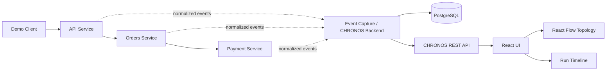

# CHRONOS — Project Context, Architecture, Roadmap, and Decision Ledger

> **Living project brief.** Read this before making architectural changes or continuing work after a context reset.
>
> **Current target:** MVP demo/release during **November 15–21, 2026**.
>
> **Last reconstructed:** October 18, 2026.
>
> **Repository:** `git@github.com:sirbasil/chronos.git` (branch: `main`, according to retained project context).
>
> **Important:** This document was reconstructed from retained project notes and the current learning conversation after the primary CHRONOS chat was deleted. It is detailed, but it cannot reproduce decisions that existed only in the deleted conversation and were not retained elsewhere. Items are labelled **Confirmed**, **Planned**, **Proposed**, **Deferred**, or **Unknown** to avoid confusing intentions with implementation.

---

## 1. Executive summary

**CHRONOS is a small, instrumented distributed-system observability and failure-experiment platform.** It runs a deliberately simple multi-service application, records normalized events from a run, stores those events, exposes the observed service topology, lets the developer intentionally cause a controlled failure, and provides an event timeline for investigating what happened.

The central story is:

> **CHRONOS watches a system, lets you break it in a controlled way, records what happened, and lets you inspect—or visually play back—the recorded run.**

This is not meant to become a production-scale observability product before the semester MVP. It is a focused systems-engineering project that demonstrates API design, networked services, event schemas, persistence, observability, failure handling, testing, and a useful developer-facing visualization.

### MVP in one sentence

Run a tiny Docker Compose system—**client → API → Orders → Payment**—capture a normalized event stream with a shared `run_id` and relevant `trace_id`, persist events and run metadata in PostgreSQL, expose the run's topology over REST, inject a controlled container-kill failure, and inspect the resulting timeline through a minimal interface.

### What CHRONOS is not (for the MVP)

- Not a replacement for a full production observability stack.
- Not Kubernetes orchestration software.
- Not a general-purpose fault-injection framework.
- Not a distributed execution engine.
- Not deterministic re-execution of all service calls.
- Not restoration or reconstruction of application state from a timeline.
- Not an automated root-cause oracle. It records and exposes evidence so a person can reason about a failure.

The word **replay** in the MVP means **play back recorded events/timeline data**. It does **not** mean re-running the original distributed computation or rebuilding the exact prior state.

---

## 2. The problem CHRONOS is intended to solve

When several services call each other, a single user request can cross multiple process boundaries. If one service fails, it can be difficult to determine:

- which services were involved in a particular run;
- the order in which requests, calls, responses, and errors occurred;
- where an error began and which downstream work was affected;
- what changed when a failure was deliberately introduced;
- whether the same experiment can be run and inspected again.

CHRONOS narrows this problem into an observable, repeatable local experiment. It gives each run an identity, normalizes events into one schema, persists them, and exposes both a service-topology view and a chronological event view.

### Target users / scenario

The primary user is the developer or student investigating a small distributed system locally. The showcase scenario should be understandable to someone who has not seen the source code: start a run, observe the service path, stop one service, and see the consequences reflected in the recorded events.

### Main value proposition

CHRONOS is valuable when it demonstrates all three outcomes:

1. **Observability:** the system captures enough structured evidence to understand a run.
2. **Causal experiment:** a controlled failure can be introduced and its effects recorded.
3. **Replayable record:** a run can be browsed afterward in a stable event sequence.

The original roadmap calls these milestones **A: Observable system**, **B: Causal experiment**, and **C: Replayable run**.

---

## 3. Scope and variant strategy

The retained roadmap explicitly names a semester/frozen-stack build and a deferred **“Mid” variant**. It does **not** contain a fully agreed, detailed specification for a separate “Full” variant. The following table preserves that distinction.

### Variant A — Semester MVP / frozen-stack variant (**current plan**)

**Purpose:** deliver a complete, understandable project by the November 15–21, 2026 target without expanding the technology surface unnecessarily.

**Stack:** Python, FastAPI, PostgreSQL, Docker Compose, React, Tailwind CSS, React Flow, and pytest. Start event capture with simple request middleware and a normalized event contract. OpenTelemetry can be added later as a capture adapter if the core implementation is stable and time allows.

**Scope:**

- Local client → API → Orders → Payment service path.
- Normalized event generation.
- `run_id` and request/trace correlation where available.
- Persist event records plus minimal run metadata.
- Retrieve a run's event timeline.
- REST topology endpoint, explicitly planned as `GET /runs/{id}/topology`.
- Topology displayed with React Flow.
- Failure injection by killing one explicitly selected local Docker container via Docker API.
- Record the injected failure and observed consequences.
- Timeline view; play/pause/step playback is desirable, but a static timeline is the agreed fallback if schedule or reliability becomes a problem.
- Tests written alongside every slice, not postponed to the end.

**Explicitly excluded from this variant:** Kafka, Kubernetes, WebSockets, network partition simulation, full deterministic replay, state reconstruction, and premature multi-language rewrites.

### Variant B — “Mid” variant (**deferred; only after the current project gate/GATE period**)

The surviving roadmap explicitly says **Go, NATS, Redis, Jaeger, and Toxiproxy (the “Mid” variant) start only after GATE**. This is not part of the November MVP.

Possible roles are described below as *candidate uses*, not commitments to add every component:

| Technology | Possible future role | Why it is deferred |
|---|---|---|
| Go | Implement one service or a selected subsystem to explore concurrency and systems programming | A rewrite now creates risk and does not help deliver the MVP. Do not rewrite all of CHRONOS in Go. |
| NATS | Introduce a message bus for event or service communication if the simple request-based design reaches a real limitation | The MVP does not need a broker to show a working service path. |
| Redis | Add ephemeral state, caching, or coordination only if a demonstrated requirement calls for it | PostgreSQL is the planned durable event store; don't add a second datastore without a defined purpose. |
| Jaeger | Visualize distributed traces when OpenTelemetry instrumentation/export is integrated | The MVP first needs its own clear normalized event model and useful local views. |
| Toxiproxy | Simulate latency, connection loss, or other network faults beyond stopping a container | The MVP's initial failure experiment is deliberately limited to killing a selected container. |
| OpenTelemetry | Provide a standard instrumentation/capture adapter and potentially export trace context | It is planned as a later adapter, not a reason to skip learning the event contract. |

Adding one of these technologies must be justified by a use case, learning goal, and test. The Mid variant is an expansion path, not a checklist.

### Variant C — Expanded / research direction (**not yet formally specified**)

Potential directions implied by the project idea include richer network-failure experiments, broader trace integration, longer-term performance measurements, or higher-fidelity replay research. These are **idea-space only**; the surviving notes do not define a committed “Full variant.”

Before pursuing this variant, first deliver and document the semester MVP. Potential future work must specify a real gap, a success metric, and the scope it replaces or extends. A visual event playback feature must not be marketed as deterministic distributed execution replay.

### Scope decision rule

When time is short, cut in this order:

1. Cut play/pause/step playback down to a static event timeline.
2. Defer optional OpenTelemetry or third-party observability integrations.
3. Defer all Mid-variant tools.
4. Defer every feature not needed to show the service path, stored events, topology, and one controlled failure experiment.

Do **not** cut the end-to-end demo, the event contract, basic tests, or documentation of how to run the project.

---

## 4. High-level architecture

### The demo service path



This is a **logical** diagram. The exact process/deployment boundary between the application API, event collector, and CHRONOS API has not been completely frozen in the retained notes. Avoid creating unnecessary services just to match the drawing. Keep the MVP architecture as simple as possible while preserving the responsibilities.

### Component responsibilities

| Component | Responsibility | MVP expectation |
|---|---|---|
| Demo client | Starts a user-like request into the service chain | Can trigger a successful run and a failure-affected run |
| API service | Accepts the incoming request and calls Orders | Basic request/response behavior and event capture |
| Orders service | Represents a downstream business service and calls Payment | Emits events and exposes failure consequences when Payment is unavailable |
| Payment service | Represents a dependency at the end of the chain | Responds normally when healthy; can be stopped/killed for a controlled experiment |
| Event contract / capture | Turns activity into normalized event objects | Every recorded event uses the common schema |
| PostgreSQL | Durable storage for event records and run metadata | Events can be retrieved by `run_id` in chronological order |
| CHRONOS backend/API | Creates or reads run records, returns events, and returns topology data | Includes `GET /runs/{id}/topology`; additional routes to be designed as implementation needs become clear |
| React UI | Makes captured information inspectable | A minimal, usable topology view and timeline |
| React Flow | Renders topology as nodes and edges | Draws services and their dependencies from the topology response |
| Docker Compose | Starts and wires the local service stack and database | One reproducible local setup command sequence |

### Control plane vs. demo application

Conceptually there are two jobs:

1. **The sample system under observation:** Client, API, Orders, and Payment.
2. **The CHRONOS control/inspection function:** event collection, run metadata, storage, topology/timeline APIs, failure control, and the UI.

The MVP does not have to split every responsibility into its own microservice. A single FastAPI application may own multiple CHRONOS endpoints while the sample Orders and Payment services remain separate processes/containers. The exact boundaries are an implementation decision to make only when needed.

### Local development and network assumptions

- Development environment: WSL Ubuntu, project directory recorded as `~/chronos`.
- The first socket exercises used `127.0.0.1` and port `8000`.
- Inside Docker Compose, each container should normally call other services by their Compose service names and container ports, not by `127.0.0.1` (which refers to that same container).
- Keep the sample services isolated to the local Compose network for the MVP.
- The component allowed to use the Docker API for failure injection must only target an explicit allowlist of the project's own Compose containers. It must not accept arbitrary host/container targets from untrusted input.

---

## 5. Core event model

**The event schema is a foundational contract.** The original roadmap explicitly says to define it before building the database, React UI, or OpenTelemetry adapter. Every downstream component should consume the same normalized event shape, regardless of which capture adapter created it.

### Canonical fields

| Field | Purpose | Notes |
|---|---|---|
| `event_id` | Unique identity for this event | Prevents ambiguity when inspecting or retrieving records |
| `run_id` | Groups events belonging to one experiment/run | Essential for filtering a run's history |
| `timestamp` | When the event occurred | Prefer a consistent UTC timestamp representation across services |
| `service_id` | Stable identity/name for the service producing the event | Use consistent names; do not mix arbitrary display labels and service IDs |
| `trace_id` | Correlates events belonging to the same request/trace | It may be absent for events that do not naturally belong to an incoming request; decide how absence is represented |
| `event_type` | Normalized classification of the event | Use the event types below rather than inventing one-off spellings |
| `source` | Identifies how/where the event was captured | For example, request middleware or a later OpenTelemetry adapter |
| `payload` | Structured event-specific details | JSON-like data; avoid secrets, credentials, and uncontrolled high-volume payloads |
| `severity` | Importance or seriousness of the event | Use a consistent small vocabulary; exact allowed values should be defined in implementation |

### Event types already specified in retained notes

- `REQUEST_START`
- `REQUEST_END`
- `SERVICE_CALL`
- `SERVICE_ERROR`
- `RESPONSE`
- `FAILURE_INJECTED`

The event type list is the known starting set, not an excuse to create duplicate names such as `HTTP_ERROR`, `API_FAILED`, and `SERVICE_FAILURE` for the same semantic event. If a new type is necessary, document it and test it.

### Required event behavior

- Every event associated with one experiment must carry the correct `run_id`.
- Where applicable, the service-to-service request path should preserve or propagate the relevant `trace_id`.
- Events should be retrievable in a reliable chronological order. If two events have identical timestamps, the implementation may need a stable tie-breaker such as insertion order or event ID; choose and document one.
- Timestamps, event types, source, and service IDs should be consistent across capture mechanisms.
- `payload` should hold event-specific details without changing the outer schema for every different event.
- Database serialization and API response serialization must follow the same contract.

### Open schema decisions

These exact choices were not frozen in surviving notes and should be resolved while implementing, rather than guessed here:

- Whether `timestamp` is stored as PostgreSQL `TIMESTAMPTZ` and how it is serialized in the API.
- Whether `payload` is stored as `JSONB` or an equivalent structured representation.
- The exact vocabulary for `severity`.
- How events outside an HTTP request receive or omit `trace_id`.
- Whether event schema versioning is needed for the first MVP. Keep it minimal unless a real compatibility problem appears.

### Minimal run metadata

The roadmap calls for persisting events **with run metadata**, but the complete table/field design is not recorded. For the MVP, run metadata should at least let CHRONOS identify a run, determine whether it completed/failed, and retrieve its events. Additional metadata—start/end time, experiment description, failure target, and status—should be added only as needed by actual features.

Do not let designing a perfect database schema delay defining the event contract and proving the end-to-end data path.

---

## 6. MVP user flow / demonstration script

A repeatable demo should tell one coherent story:

1. Start the database and sample services with Docker Compose.
2. Start or create a run and assign a `run_id`.
3. Send a request from the demo client.
4. Observe it travel through API → Orders → Payment.
5. Capture structured events for the request, inter-service call(s), response(s), and run outcome.
6. Persist the events and run metadata in PostgreSQL.
7. Ask CHRONOS for the run timeline and its topology.
8. Display services/nodes and their directed edges through the React Flow-based topology view.
9. Start a second run or clearly marked experiment, then intentionally kill one selected local service container using the approved control path.
10. Record the `FAILURE_INJECTED` event and the resulting observable errors/failed requests.
11. Compare the normal and failure-affected runs through the event timeline. If interactive playback is stable, offer play/pause/step; otherwise show a well-ordered static timeline with event details.
12. Reset/restart the Compose services and repeat the demo from the README.

The demo should prove the system works. It should not rely on a pre-recorded screenshot, an undocumented manual database edit, or an event log generated by a different run.

---

## 7. REST API surface

### Explicitly planned endpoint

| Method | Path | Status | Purpose |
|---|---|---|---|
| `GET` | `/runs/{id}/topology` | **Planned in the retained roadmap** | Return service nodes and dependency edges for a run; the React Flow UI uses this response |

### Routes likely to be useful, but not frozen

| Method | Candidate path | Purpose | Status |
|---|---|---|---|
| `GET` | `/health` | Check whether an API process is up | Conventional proposal; not recorded as an agreed endpoint |
| `GET` | `/runs` | List recorded runs | Candidate; define only if the UI needs it |
| `GET` | `/runs/{id}` | Return run metadata | Candidate |
| `GET` | `/runs/{id}/events` or `/runs/{id}/timeline` | Fetch ordered events for the run | Candidate; choose one canonical name, do not implement both without a reason |
| `POST` | `/runs` | Create a run / experiment | Candidate; exact lifecycle design still open |
| `POST` | `/runs/{id}/failure` | Request an approved failure injection | Candidate; must restrict target to known local Compose services |

These are design candidates, not claims that they already exist. Implement the minimum route surface needed by the demo and test API behavior with pytest. For errors, distinguish route-not-found or validation problems from a failed downstream dependency; return clear status codes and structured responses.

### API design principles

- REST only for the MVP topology endpoint; **no WebSockets** in the retained plan.
- Keep routes predictable and document method + path together.
- Use stable JSON response shapes and consistent error handling.
- Do not return invented or inferred topology data if it cannot be grounded in recorded service-call evidence or configured service relationships. State the topology source explicitly in implementation docs.
- A request to inject failure is a privileged control action, not an arbitrary shell/host command interface.

---

## 8. Failure experiments

### MVP failure mode: container kill

The first failure experiment is intentionally narrow: **kill one selected target container through the Docker API** and record both the action and resulting system behavior.

Expected event evidence could include:

- a `FAILURE_INJECTED` event associated with the experiment;
- service-call events preceding the failure;
- a service error or failed dependency request after the target becomes unavailable;
- a response/error outcome visible to the client;
- consistent `run_id` and relevant `trace_id` so the timeline can be correlated.

The exact sequence depends on where the failure is injected. For example, killing Payment may cause Orders to see a downstream connection failure; killing Orders may cause the API service to fail calling Orders. The MVP should demonstrate one reproducible target and one documented consequence before adding more combinations.

### Not in the MVP

- Network partition or packet delay/loss simulation.
- Arbitrary host process killing.
- Production environment controls.
- Broad chaos engineering features or a scheduler for large-scale experiments.

Toxiproxy/network faults belong to the deferred Mid/future work. For safe local operation, only expose the services and containers required by the demo and hard-code or validate the allowable failure targets.

### Causal-experiment claim

For MVP, “causal experiment” means **you deliberately change one defined condition and record the observed consequences for comparison**. It does not mean a general-purpose causal inference engine has proved every causal relationship in an arbitrary distributed system.

---

## 9. Timeline replay: exact meaning and fallback

### Desired MVP experience

A timeline view lists events in chronological order. An event detail panel should show, at minimum where available:

- timestamp;
- service;
- event type;
- trace ID;
- payload/details;
- status or severity.

If it can be completed reliably, the UI can provide play, pause, and step controls to move through the **recorded event timeline**.

### Fallback if time is short

The retained plan explicitly says to **cut replay to a static timeline view before moving dates or touching anything else**. A clear static list with usable event details is preferable to a fragile player.

### Important terminology guardrail

This feature is *timeline playback*. It does **not**:

- issue the original HTTP requests again;
- restore the original database state;
- control external side effects to make them deterministic;
- reproduce arbitrary service execution from captured events.

True execution replay and state reconstruction are future research directions only if they are later designed and implemented explicitly. Do not claim those capabilities in the README or demo for this MVP.

---

## 10. Technology stack and rationale

The semester stack is intentionally frozen to prevent tool sprawl.

| Technology | Role in CHRONOS | Current decision |
|---|---|---|
| Python | Main backend language and fastest route to working services/API/event processing | **Keep for MVP** |
| FastAPI | API routes, request handling, JSON responses, input validation as needed | **Current learning/build path** |
| Uvicorn | Runs the FastAPI ASGI application in development | **Current development server** |
| PostgreSQL | Durable store for normalized events and run metadata | **Planned** |
| Docker Compose | Reproducibly runs client, application services, CHRONOS components, and database locally | **Planned/required for the composed MVP** |
| React | Frontend UI | **Planned** |
| Tailwind CSS | Frontend styling | **Planned** |
| React Flow | Service-topology visualization using nodes and edges | **Planned** |
| pytest | Automated tests, written slice by slice | **Planned/required quality practice** |
| OpenTelemetry | Later instrumentation/capture adapter | **Deferred until core event capture is working** |
| Go | Possible later service or subsystem in Mid variant | **Deferred** |
| NATS | Possible later messaging/event transport | **Deferred** |
| Redis | Possible later ephemeral state/cache/coordination | **Deferred** |
| Jaeger | Possible trace visualization when trace export is integrated | **Deferred** |
| Toxiproxy | Possible richer network fault simulation | **Deferred** |

### Why not add every systems tool now?

The point of the MVP is to demonstrate a reliable, comprehensible data path and experiment. Each new datastore, broker, observability server, language, or orchestrator consumes design/debugging time. Add a tool only when the current implementation proves a need or when the next variant has been deliberately approved.

### Technology explicitly parked for this phase

- Kubernetes.
- Kafka.
- Go rewrite.
- Advanced CUDA, Triton, vLLM, quantization, KV cache, or distributed training work unrelated to the CHRONOS MVP.
- Network-fault simulation beyond container termination.

This is not a statement that the technologies are bad. They are simply not needed to ship the current version.

---

## 11. Current development and learning status

The state below separates things practiced in the conversation from work that is **not verified as a committed/running repo feature**.

### Concepts and experiments practiced

- Raw TCP server/client using Python sockets.
- `bind`, `listen`, `accept`, client `connect`, `sendall`, and `recv`.
- Difference between the listening socket and the accepted client socket.
- Bytes vs. strings (`encode` / `decode`).
- Manual HTTP request formatting and the `\r\n\r\n` header/body separator.
- Manual HTTP response status, headers, body, `Content-Length`, and JSON body.
- A small client-side parser that accumulates bytes until headers and a declared content-length body have arrived.
- Why one `recv(1024)` is not guaranteed to equal one complete HTTP message.
- A manual server with success (`200`), missing route (`404`), and error (`500`) behavior.
- Python `requests` client and response fields such as `.status_code`, `.headers`, `.text`, `.json()`, plus timeout and exception handling concepts.
- Python's built-in `http.server` / `HTTPServer` server and `BaseHTTPRequestHandler`.
- Server lifecycle (`serve_forever()`), local ports, connection refusal when nothing is listening, and address/port binding conflicts.
- Beginning FastAPI: what the `FastAPI` application object, route decorator, and handler function mean.

### FastAPI code drafted in the current conversation

The user wrote a small app with:

- `app = FastAPI()`
- `GET /` returning `{"message": "Hello from CHRONOS"}`
- `GET /orders` returning `{"message": "Orders service"}`

The code shown in chat was correct. **It has not been confirmed here that it was saved to disk, launched via Uvicorn, or tested in `/docs`.** The next action is to verify that manually, not assume it is complete.

### Local environment details observed in this conversation

- WSL Ubuntu.
- Project root: `~/chronos`.
- Development folder: `~/chronos/slice-0/01-http-basics`.
- The activated virtual environment's package location showed `~/chronos/slice-0/01-http-basics/.venv/lib/python3.14/site-packages`.
- Observed package versions at the time: FastAPI `0.143.0`, Uvicorn `0.54.0`.
- Python is from a `python3.14` virtual environment according to the package path.
- The manual socket experiments used `127.0.0.1:8000`.
- GitHub repository is recorded as `sirbasil/chronos`, branch `main`.

Do not assume the project uses a root-level `~/chronos/.venv`: the observed package path points to the environment under `slice-0/01-http-basics/.venv`. Verify the filesystem before changing environment layout.

### Git state caveat

Retained context suggests raw TCP/HTTP experiments were pushed, but the exact current commit/status was not verified after the chat deletion. Before making structural changes, run `git status`, inspect the current files and recent commits, and preserve experiments rather than overwriting them. The exact existence/content of `server_raw.py` and `server_fastapi.py` should be checked in the real repository.

### Current project maturity assessment

Based only on the retained learning discussion, implementation maturity is **earlier than the planned October data-path checkpoint**. The networking foundations and first FastAPI route attempt are practiced; the following are not verified as implemented: multi-container application, Docker Compose setup, normalized event middleware, PostgreSQL storage, topology endpoint, frontend topology, Docker API failure control, and timeline UI. This is a planning baseline, not a judgment on any unseen repository changes.

---

## 12. Roadmap and updated deadline

### The deadline decision

The latest explicit project constraint is **MVP by the third week of November 2026, i.e. November 15–21**. This supersedes the earlier broader November 23–29 hard-freeze schedule as the target for delivering the MVP. The older plan remains useful as a record of intended slices, but is no longer the controlling deadline.

The compressed schedule is aggressive because the retained implementation evidence only shows networking exercises and the beginning of FastAPI. Scope must stay thin. The goal is not to install the whole stack; it is to get one end-to-end demo working, recorded, and repeatable.

### Recommended re-baseline from October 18

| Window | Focus | Exit condition |
|---|---|---|
| **Oct 18–21** | Verify current code; finish FastAPI fundamentals through self-written routes; understand request/response and path parameters | App launches with Uvicorn; `GET /` and `GET /orders` behave as expected; tests/manual checks cover success and missing routes |
| **Oct 22–27** | Build the thinnest local service chain; introduce Docker Compose as needed, not as a theory course | Client → API → Orders → Payment works once end to end locally |
| **Oct 28–Nov 2** | Freeze the event contract; capture normalized events and persist them with run metadata in PostgreSQL | A completed run has ordered events that can be fetched by `run_id` |
| **Nov 3–7** | Build the topology REST endpoint and minimal React/React Flow representation | `GET /runs/{id}/topology` returns real nodes/edges; UI renders the run topology, or a tested API-only topology if UI is behind |
| **Nov 8–12** | Controlled container-kill failure experiment; record action and downstream consequences | One documented failure experiment is repeatable and its events are persisted |
| **Nov 13–17** | Timeline UI; interactive play/pause/step only if the data path and failure records are reliable | Preferred: interactive timeline. Minimum fallback: chronological static timeline and event-detail view |
| **Nov 18–21** | Integration, test fixes, runbook, architecture diagram, clean demo | A fresh environment can be started from documented steps and the entire demo can be repeated |

This is a **recommended recovery plan**, not the exact historical schedule. Dates may be adjusted after an actual repository audit, but the MVP target should not quietly slip just to accommodate optional tools.

### Minimum acceptance criteria for the November MVP

- [ ] Fresh checkout/setup instructions are accurate.
- [ ] Docker Compose starts the required local services and PostgreSQL.
- [ ] The demo client can exercise API → Orders → Payment.
- [ ] Each run has a unique `run_id` and useful trace correlation where applicable.
- [ ] Event capture emits the agreed schema and event types.
- [ ] Events and run metadata persist in PostgreSQL.
- [ ] Events can be retrieved in stable chronological order.
- [ ] `GET /runs/{id}/topology` returns the service topology for that run or clearly documented configured topology.
- [ ] The UI renders the topology if time permits; API topology is tested either way.
- [ ] A deliberately killed local service creates a `FAILURE_INJECTED` record and observable downstream events.
- [ ] A timeline shows what happened; static timeline is acceptable if playback is unstable.
- [ ] pytest covers each completed slice and the critical API/event behaviors.
- [ ] No production credentials/secrets are committed.
- [ ] README includes architecture, setup, demo script, limitations, and screenshots/recorded evidence.

### Historical milestones from the earlier plan

These were the original intended slices and dates. They are retained for context, not as a reason to ignore the newer deadline:

- **Slice 0, Oct 2–5:** tiny Docker Compose demo and event schema.
- **Slice 1, Oct 6–11:** event capture via request middleware.
- **Slice 2, Oct 12–18:** PostgreSQL persistence and retrieving a run timeline; October 18 was the original complete-data-path checkpoint.
- **Slice 3, Oct 24–31:** topology endpoint and React Flow; REST-only, no WebSockets; originally labelled MVP v0.1.
- **Slice 4, Nov 1–9:** inject failure by killing a target container and record consequences.
- **Slice 5, Nov 10–16:** timeline playback and event detail panel, without execution replay or state reconstruction.
- **Nov 17–22:** integration and reliability in the old plan.
- **Nov 23–29:** previous hard-freeze/polish window; superseded as the primary delivery target by the newer November 15–21 MVP deadline.

---

## 13. Testing and quality strategy

The earlier roadmap requires **a pytest test for each slice as part of that slice**. Testing is part of implementation, not a cleanup step at the end.

### Suggested test layers

1. **Unit tests:** event serialization/validation, normalization, event-type consistency, and transformation of recorded calls into topology nodes/edges.
2. **API tests:** successful routes, unknown route behavior, invalid run IDs, absent runs, and stable JSON response schemas.
3. **Persistence tests:** insert a run and several events; retrieve the run's events in chronological order; verify event/run relationships.
4. **Integration tests:** run the service chain and verify a single request generates the expected correlated events.
5. **Failure experiment test:** inject a controlled container stop/kill, then verify the failure action and observed error evidence appear in the run record. Do not make tests depend on an uncontrolled external system.
6. **Smoke/demo test:** follow the README from a clean start and verify the essential end-to-end demonstration.

### Reliability and error-handling expectations

- A missing route should not be confused with a refused TCP connection.
- A downstream failure should generate a useful event and a clear client-facing outcome.
- A CHRONOS query for a nonexistent run should return a clear not-found response, not an unhandled traceback.
- Timeouts should be intentional on service-to-service HTTP calls so a stopped dependency cannot hang the demo indefinitely.
- Logging and event capture should not recursively generate an infinite stream of events about the event recorder itself.
- Avoid making the event store a silent single point of failure; the MVP should surface capture/storage errors clearly even if it cannot operate through them.
- Don't claim stronger reliability than tests and demonstrations support.

---

## 14. Repository structure guidance

The only path structure confirmed in retained context is `~/chronos/slice-0/01-http-basics`. Use the existing repository layout as the authority. Do not rename folders solely to match this suggestion.

A possible target structure after the basics phase is:

```text
chronos/
├── README.md
├── CHRONOS_CONTEXT.md
├── docker-compose.yml
├── .env.example
├── .gitignore
├── docs/
│   ├── architecture.md
│   ├── event-schema.md
│   └── demo-runbook.md
├── slice-0/
│   └── 01-http-basics/
│       ├── client.py
│       ├── server.py
│       ├── server_raw.py          # if this experiment file exists; preserve it
│       └── server_fastapi.py      # if this is the chosen location
├── services/
│   ├── api/
│   ├── orders/
│   └── payment/
├── chronos_backend/
│   ├── events/
│   ├── runs/
│   └── topology/
├── frontend/
├── tests/
│   ├── unit/
│   ├── api/
│   └── integration/
└── migrations/                    # only if a migration system is selected
```

This is a **proposed destination**, not a statement of current repository contents. Start by inspecting what already exists. Small, understandable modules are better than a large speculative directory tree that sits empty.

### Git practices for this project

- Use meaningful commits at slice boundaries.
- Keep raw TCP/HTTP learning experiments if they help explain the networking foundations; they can be clearly labelled as experiments.
- Commit `.env.example`, not live secrets.
- Put Python virtual environments, caches, build output, and local database files in `.gitignore`.
- Before any restructuring, check `git status` and make sure valuable uncommitted work is preserved.
- Each slice should finish with tests and a short note describing how to run it.

---

## 15. Development/learning workflow expectations

The user has explicitly said they want to **write the code themselves and understand it**, not receive complete copy-paste implementations. This is part of the project plan and should be respected in future sessions.

### Teaching loop

1. Explain the concept and why CHRONOS needs it.
2. Give one small implementation task—not the complete answer.
3. Let the user attempt it.
4. Review the user's code and reasoning.
5. If stuck, provide a hint or focused example, escalating gradually.
6. Help debug the actual error and explain why it occurred.
7. Test the result, then connect it to the next CHRONOS slice.

Do not dump a full application or several files unless the user explicitly asks. Do not move to the next technology before the user has a usable mental model of the current one.

### Learning progression already underway

- Socket and TCP basics.
- HTTP message structure and request/response distinction.
- Client/server lifecycle and port binding.
- Python `requests` as an HTTP client library.
- `http.server` as a standard-library server.
- FastAPI app object, `@app.get(...)`, route functions, JSON responses, and route matching.
- Next concepts: path parameters, request methods, JSON body parsing/validation, service-to-service calls, error handling/timeouts, testing, then Docker Compose and persistence as the implementation requires.

Teaching must be driven by the MVP deliverable. Avoid learning every detail of FastAPI before writing a useful endpoint; likewise, do not bring in Kubernetes, brokers, or Go before the basic data path works.

---

## 16. Risks and design guardrails

| Risk | Mitigation / decision |
|---|---|
| Deadline is tighter than the original roadmap | Keep one thin vertical slice; cut interactive replay to static timeline before moving the deadline or adding tools |
| Too much time spent learning without shipping | Each lesson should end in a small tested artifact that advances one slice |
| Technology sprawl | Treat the semester stack as frozen; defer Mid-variant tools until after the relevant gate/GATE period |
| Schema drift between services | Define and test the normalized event schema first; keep capture adapters behind it |
| Losing context again | Keep this file current, plus README/architecture/demo-runbook in Git; update after significant decisions |
| Confusing visualization with replay | Document that MVP replay is event playback only, not re-execution/state reconstruction |
| Unsafe or overly broad failure control | Restrict Docker control to named local Compose services; no arbitrary container or host commands |
| Misleading topology | Derive from actual event/call evidence or explicitly documented config; don't claim dynamic discovery if the implementation is static |
| Unverified status assumptions | Mark feature status only after checking code, tests, and a repeatable run |
| Fragile demo | Add tests alongside slices and rehearse a clean setup before the deadline |

### Architecture principles

- **Event schema first.**
- **One usable end-to-end path before broad feature coverage.**
- **Tests at every slice.**
- **REST-only topology for MVP.**
- **Local, controlled failure injection only.**
- **No Go rewrite before MVP.**
- **No full replay claims.**
- **Prefer evidence over claims:** show test output, recorded runs, and a reproducible demo.

---

## 17. Future development roadmap

Future work should be gated by a stable MVP, real gaps, and the user's available time.

### Post-MVP stabilization

- Keep the setup one-command or clearly scripted.
- Make event persistence and run retrieval robust.
- Improve error handling, input validation, edge cases, and tests.
- Add a few basic performance measurements once the core works.
- Make the topology and timeline views easy to explain.
- Record one baseline run and one failure-injected run with evidence.
- Document what the implementation can and cannot claim.

### Stage 2 / Mid variant after the deferred gate

Possible planned options, each subject to an explicit decision:

- Add OpenTelemetry instrumentation/export as a standard capture adapter while preserving the normalized CHRONOS event shape.
- Use Jaeger for trace exploration if it improves the debugging experience.
- Use Toxiproxy to simulate network delay/disconnects beyond a container kill.
- Evaluate NATS for asynchronous messaging if the architecture has a genuine event-transport requirement.
- Evaluate Redis only for a defined cache/ephemeral-state/coordination need.
- Introduce Go for a selected service/subsystem if there is a concrete concurrency or learning objective—not a wholesale rewrite for fashion.

### Longer-horizon research possibilities (uncommitted)

- Additional failure modes and repeatable experiment definitions.
- Better causal comparison between baseline and fault-injected runs.
- Performance measurement: latency, error rate, throughput, and where available resource use.
- Schema/versioning and more robust capture adapters.
- More sophisticated replay only after establishing what “replay” should guarantee and how nondeterminism, external side effects, and state are handled.
- Larger deployment environments only if there is a measured need; Kubernetes is not part of the current plan.

No new feature enters active work merely because it is technically interesting. Define the gap, the expected result, how it will be tested, and which existing commitment it displaces.

---

## 18. Decision log and current unknowns

### Decisions that are retained and should be treated as authoritative

- CHRONOS is the primary project in the current semester build.
- The MVP path is a tiny client → API → Orders → Payment service chain.
- The semester stack is Python + FastAPI + PostgreSQL + Docker Compose + React + Tailwind + React Flow + pytest.
- The normalized event schema is `event_id`, `run_id`, `timestamp`, `service_id`, `trace_id`, `event_type`, `source`, `payload`, `severity`.
- Known event types: `REQUEST_START`, `REQUEST_END`, `SERVICE_CALL`, `SERVICE_ERROR`, `RESPONSE`, `FAILURE_INJECTED`.
- Milestones: A Observable system (slices 0–3), B Causal experiment (slice 4), C Replayable run (slice 5).
- Topology endpoint: `GET /runs/{id}/topology`; REST only, no WebSockets.
- Failure injection for MVP: kill a named/allowed target container through Docker API; network partition is deferred.
- Timeline playback is not execution replay and not state reconstruction.
- If behind, cut replay to a static timeline before moving dates or adding scope.
- Go, NATS, Redis, Jaeger, and Toxiproxy belong to a deferred Mid variant after the relevant gate/GATE period.
- Current MVP target is November 15–21, 2026; this supersedes the earlier November 23–29 hard-freeze plan as the delivery target.
- The user should write code themselves; guidance should use tasks/hints/reviews rather than full solution dumps.

### Questions to resolve during implementation

1. What exactly is already present and committed in the current repo? Inspect before changes.
2. Will CHRONOS event capture and topology API live in one FastAPI app for the MVP, or be split into a separate backend process?
3. What are the exact PostgreSQL tables and minimal run-metadata fields?
4. How is `run_id` created and propagated through each sample service?
5. How is `trace_id` propagated if a request crosses services? Is there a simple header for the MVP?
6. Is topology computed from recorded `SERVICE_CALL` events, configured service definitions, or a combination? This must be explicit.
7. Which exact local Compose service is the first failure-injection target?
8. What is the minimum UI screen structure? Prefer one topology view and one timeline, not a full dashboard.
9. Are the raw experiments and first FastAPI routes saved and committed, or only drafted in conversation?
10. What exact success/error response schema is used for the Orders and Payment services?

Resolve these questions only when the next slice needs them. Don't block the entire build on speculative architecture perfection.

---

## 19. Suggested next actions (as of October 18, 2026)

1. In WSL, inspect the repository before editing anything: `git status`, `git log --oneline -5`, and list the files in `slice-0/01-http-basics`.
2. Verify which virtual environment is active. The observed FastAPI/Uvicorn package location was `slice-0/01-http-basics/.venv/lib/python3.14/site-packages`; do not assume the virtual environment is at the project root.
3. Save and run the user's FastAPI app; test `GET /` and `GET /orders` in `/docs` or with the existing client.
4. Add a route with a path parameter only after explaining the idea and letting the user attempt it.
5. Build the service chain in the smallest increments possible, keeping the user responsible for writing code and explaining their decisions.
6. Re-baseline the implementation status after inspecting the actual repository, then keep the November 15–21 delivery target visible.
7. Commit this file to the repository as `CHRONOS_CONTEXT.md` and update it whenever a real architectural or deadline decision changes.

---

## 20. How to maintain this context file

After any important project session, update only the sections that actually changed:

- **Current status:** mark a feature implemented only if it is saved, runnable, and tested.
- **Roadmap:** adjust dates openly; do not silently change the MVP acceptance criteria.
- **Decision log:** record the decision, date, reason, and impact on scope.
- **Unknowns:** remove a question only once it has been resolved in code or by an explicit decision.
- **Variant status:** keep Mid/future ideas deferred until the MVP is stable and there is capacity to pursue them.

If another ChatGPT conversation is started, begin by sharing this file and saying: **“Use `CHRONOS_CONTEXT.md` as the project context. Preserve the current scope and November 15–21 MVP target. Let me write the code; give hints and review my attempts rather than dumping complete implementations.”**

---

*End of CHRONOS context.*
