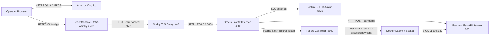

# CHRONOS

**CHRONOS** is an instrumented distributed-system observability and controlled failure-experiment platform built around a containerized Orders-to-Payment workflow. It assigns each experiment a server-generated `run_id`, captures normalized lifecycle and error telemetry into PostgreSQL, reconstructs service topology from recorded events over REST, enables RBAC-protected controlled container termination through a network-isolated Failure Controller sidecar, and visualizes run timelines and service graphs inside a dual-mode (`LIVE` / offline `PREVIEW`) React telemetry console protected by Amazon Cognito OAuth2 PKCE authentication.

---

## 1. Problem Statement

When a single client request crosses service and database boundaries, diagnosing a downstream outage requires answering four questions accurately:

1. Which services participated in the execution path?
2. In what chronological sequence did requests, inter-service calls, faults, and failures occur?
3. Did an outage occur before or during request execution, and which dependency failed?
4. Can the failure scenario be reproduced, inspected, and audited without exposing privileged host infrastructure controls on the public API surface?

Traditional monitoring stacks separate logs, traces, health probes, and fault-injection tooling, making causal experimentation heavyweight for small multi-service environments. CHRONOS unifies normalized event capture, persistent run correlation, causal failure injection, and visual timeline inspection in a reproducible Docker Compose and AWS MVP architecture.

---

## 2. Project Objectives

- **Observability:** Capture normalized JSON telemetry (`ChronosEvent`) across API handlers, downstream service calls, and fault injections under a consistent `run_id`.
- **Causal Experimentation:** Trigger deterministic, fail-closed controlled container failure (`SIGKILL` on `payment`) via an isolated internal controller without granting the public API direct Docker daemon privileges.
- **Persistent Audit & Replayable Inspection:** Persist runs and chronological events in PostgreSQL so completed, failed, and in-progress experiments remain browsable alongside derived service topology graphs.
- **Zero-Trust Boundaries & Verification:** Enforce RS256 Cognito JWT authentication, group-based RBAC (`chronos-admins`, `chronos-operators`), non-root container execution (`uid=1001`), and automated + end-to-end verification across local and AWS environments.

---

## 3. Key Features

- **Unified Run & Checkout Orchestration (`POST /runs`, `POST /orders/{order_id}/checkout`):** Creates tracked experiment runs (`IN_PROGRESS` -> `COMPLETED` / `FAILED`), prevents duplicate checkout execution on the same `run_id` via row-locked database claims, and handles timeouts (`504`), connection failures (`503`), and upstream errors (`502`).
- **Normalized Event Contract (`ChronosEvent`):** Validates six canonical event types (`REQUEST_START`, `SERVICE_CALL`, `RESPONSE`, `SERVICE_ERROR`, `FAILURE_INJECTED`, `REQUEST_END`) stored in PostgreSQL `JSONB` with microsecond UTC ordering.
- **Derived Service Topology (`GET /runs/{run_id}/topology`):** Dynamically builds deduplicated service nodes and directed `SERVICE_CALL` edges directly from persisted run events.
- **Isolated Failure Injection (`POST /runs/{run_id}/failure`):** Delegates `payment` termination over an internal-only Docker network (`internal: true`) using constant-time shared-secret authentication (`hmac.compare_digest`), single-flight concurrency locks, post-kill container state polling, and bounded retry event persistence.
- **Cognito PKCE & RBAC Security:** Frontend Amplify v6 OAuth2 Authorization Code + PKCE login paired with backend RS256 JWKS signature verification, strict `token_use == "access"` checks, and operator/admin group authorization.
- **Instrument Console UI:** React 18 + TypeScript + Tailwind CSS cockpit displaying an interactive multi-track trace timeline (`0.75X`–`2.5X` zoom, `PRE` failure bay, scrubber cursor), React Flow (`@xyflow/react`) topology graph, service health matrix, raw JSONB context inspector, and offline demo `PREVIEW` fixtures.

---

## 4. Architecture Overview

CHRONOS separates responsibilities across four backend runtime components behind an edge reverse proxy and hosted SPA frontend:

- **Web Frontend (`frontend/`):** Static React/Vite bundle (hosted on AWS Amplify in production) performing Cognito PKCE sign-in and querying Orders over HTTPS with `Authorization: Bearer <access_token>`.
- **Orders Service (`backend/server_fastapi.py`):** Public FastAPI API (`127.0.0.1:8000` behind Caddy TLS in production) responsible for JWT verification, run lifecycle state transitions, checkout orchestration, PostgreSQL persistence, topology construction, and guarded failure delegation.
- **Payment Service (`backend/payment_service.py`):** Minimal FastAPI downstream microservice on the private `default` Docker network (`:8001`), configured with `restart: "no"` so injected `SIGKILL` outages remain deterministic until explicit recovery.
- **Failure Controller (`backend/failure_controller/main.py`):** Hardened internal-only microservice (`read_only: true`, `cap_drop: ALL`, `no-new-privileges: true`, non-root `chronos:1001`) attached strictly to the `failure-control` internal network (`:8002`) with allowlisted `payment` container termination via `/var/run/docker.sock`.
- **PostgreSQL 16 (`postgres:16-alpine`):** Persistent store (`runs` and `events` tables) isolated from public ingress and unreachable from `failure-controller`.

### Architecture Diagram



---

## 5. Technology Stack

| Layer | Technology | Version / Configuration |
|---|---|---|
| Backend API & Gateway | Python, FastAPI, Uvicorn | Python `3.14` (`3.14.4` local / `3.14.10` containers), FastAPI `0.143.0`, Uvicorn `0.54.0` |
| Data Persistence | PostgreSQL, `psycopg` | PostgreSQL `16-alpine`, `psycopg 3.3.7` + `psycopg-binary`, JSONB payloads |
| Authentication | Amazon Cognito, `PyJWT[crypto]` | OAuth2 Authorization Code + PKCE, RS256 JWKS verification (`PyJWT 2.15.1`) |
| Failure Injection | Docker SDK (`docker==7.2.0`) | Isolated sidecar container (`internal: true`, `chronos` UID `1001`) |
| Frontend | React, TypeScript, Vite, Tailwind CSS | React `18.3`, TypeScript `5.6`, Vite `6.4`, `@xyflow/react 12.12`, `aws-amplify 6.22` |
| Testing | `pytest`, Node.js `node:test` | `132` backend tests (`pytest`), `10` frontend telemetry/UI logic tests |
| Production Edge & Hosting | AWS EC2, Docker Compose, Caddy, AWS Amplify, ECR, S3, SSM | `t3.small` Ubuntu 24.04 (`ap-south-1`), Let's Encrypt TLS, ECR OCI images |

---

## 6. Repository Structure

```text
chronos/
├── README.md                              # Project overview, setup, API, security & deployment guide
├── CHRONOS_CONTEXT.md                     # Historical project brief, design notes & decision log
├── CHRONOS_SECURITY_REMEDIATION_REPORT.md # ECR CVE audit, zlib remediation & glibc residual risk analysis
├── CHRONOS_EMERGENCY_READINESS_REPORT.md  # Pre-deployment submission readiness audit
├── amplify.yml                            # AWS Amplify frontend build specification
├── deploy/
│   └── Caddyfile                          # Reverse proxy TLS termination configuration
├── docs/
│   ├── AWS_COGNITO_SETUP.md               # Cognito User Pool, JWT verification & RBAC architecture
│   ├── AWS_DEPLOYMENT.md                  # EC2 deployment, S3 backup/restore & AWS retirement runbooks
│   ├── CHRONOS_TECHNICAL_REPORT.md        # Consolidated engineering & academic technical report
│   └── CHRONOS_SUBMISSION_PRESENTATION.pptx # Editable 15-slide submission deck
├── backend/
│   ├── Dockerfile.orders                  # Non-root (UID 1001) patched Orders image build
│   ├── Dockerfile.payment                 # Non-root (UID 1001) minimal Payment image build
│   ├── docker-compose.yml                 # Local multi-container stack
│   ├── docker-compose.failure-injection.yml # Local failure-injection compose override
│   ├── requirements.txt                   # Pinned Orders backend dependencies
│   ├── requirements.payment.txt           # Minimal Payment service dependencies
│   ├── server_fastapi.py                  # Core Orders API, checkout, runs, events & topology routes
│   ├── payment_service.py                 # Downstream Payment FastAPI microservice
│   ├── database.py                        # PostgreSQL schema initialization & atomic run/event queries
│   ├── event_schema.py                    # Canonical ChronosEvent Pydantic model
│   ├── auth.py                            # Cognito RS256 JWT validation, JWKS cache & RBAC dependencies
│   ├── failure_injector.py                # Orders-side single-flight client & event persistence
│   ├── .env.example                       # Sanitized backend environment template
│   ├── deploy/
│   │   └── compose.prod.yml               # Production Compose template
│   ├── failure_controller/
│   │   ├── Dockerfile                     # Hardened read-only/non-root controller image build
│   │   ├── main.py                        # Allowlisted Payment SIGKILL service
│   │   └── requirements.txt               # Controller dependencies
│   └── tests/                             # 132 automated pytest tests across 8 test modules
└── frontend/
    ├── package.json                       # React, Vite, TypeScript, React Flow & Amplify dependencies
    ├── .env.example                       # Sanitized public frontend Vite variable template
    ├── src/
    │   ├── App.tsx                        # Cockpit workspace, auth gate, LIVE/PREVIEW switcher
    │   ├── auth/                          # Amplify configuration & AuthContext state machine
    │   ├── components/                    # Header, Navigation, Inspector, StatusStrip, monitor/ & views/
    │   ├── services/chronosApi.ts         # Timeout-guarded REST client with Bearer token injection
    │   ├── utils/                         # Event transformation, timeline layout & navigation helpers
    │   └── types/                         # TypeScript domain contracts
    └── tests/
        └── runTelemetry.test.ts           # 10 unit tests covering UTC math, RBAC, telemetry & layout
```

*(Note: `backend/client.py`, `client_raw.py`, `server.py`, and `server_raw.py` remain in `backend/` as early socket/HTTP learning artifacts and are excluded from Docker runtime images.)*

---

## 7. Prerequisites

- **Docker Engine** & **Docker Compose v2** (`docker compose`)
- **Python 3.12+** (tested locally on Python `3.14.4`, containers build on Python `3.14-slim`)
- **Node.js 20.x+** and **npm 10.x+** (tested with Node `v20.20.2`)
- **PostgreSQL 16** (provided automatically via Docker Compose for both runtime and local test DB usage)
- Optional for live authenticated mode: access to the configured Amazon Cognito User Pool (`ap-south-1_tDVeeHq0g`); otherwise the frontend provides an offline `PREVIEW` mode for telemetry UI inspection.

---

## 8. Environment Configuration

Copy the sanitized templates before running locally. **Never commit `.env`, `.env.local`, database dumps, or real tokens.**

### Backend (`backend/.env` from `backend/.env.example`)

| Variable | Purpose | Example / Notes |
|---|---|---|
| `POSTGRES_USER`, `POSTGRES_PASSWORD`, `POSTGRES_DB` | PostgreSQL credentials | Never use default `changeme` in production |
| `POSTGRES_HOST`, `POSTGRES_PORT` | DB host/port | `postgres` inside Compose, `127.0.0.1` for host pytest |
| `PAYMENT_SERVICE_URL` | Internal Payment URL | `http://payment:8001` inside Compose (`http://127.0.0.1:8001` on host) |
| `ENABLE_FAILURE_INJECTION` | Feature flag for `/runs/{id}/failure` | `false` (default fail-closed) or `true` |
| `COMPOSE_PROJECT_NAME` | Target Compose project label filter | `01-http-basics` |
| `FAILURE_CONTROLLER_URL`, `FAILURE_CONTROLLER_TOKEN` | Internal controller URL and shared secret | Generate secret with `openssl rand -hex 32` |
| `DOCKER_GID` | Host `/var/run/docker.sock` GID | Check with `stat -c '%g' /var/run/docker.sock` |
| `APP_ENV` | Startup strictness mode | `development` (`503` if Cognito unset) or `production` (halts startup if unset) |
| `COGNITO_REGION`, `COGNITO_USER_POOL_ID`, `COGNITO_USER_POOL_CLIENT_ID` | Cognito JWT verification settings | Must match target User Pool & App Client |
| `COGNITO_ADMIN_GROUP`, `COGNITO_OPERATOR_GROUP` | Authorized RBAC groups | `chronos-admins`, `chronos-operators` |
| `CORS_ALLOWED_ORIGINS` | Allowed browser origins (comma-separated) | Wildcard `*` is explicitly stripped/rejected |

### Frontend (`frontend/.env.local` from `frontend/.env.example`)

All `VITE_*` variables are bundled into client JavaScript—never place secrets here:

- `VITE_API_BASE_URL` (defaults to `http://127.0.0.1:8000` if omitted)
- `VITE_COGNITO_REGION`, `VITE_COGNITO_USER_POOL_ID`, `VITE_COGNITO_USER_POOL_CLIENT_ID`
- `VITE_COGNITO_OAUTH_DOMAIN`
- `VITE_COGNITO_REDIRECT_SIGN_IN`, `VITE_COGNITO_REDIRECT_SIGN_OUT` (Cognito OAuth callbacks default to origin)

---

## 9. Local Setup & Docker Compose Execution

### 1. Configure Environment

```bash
cp backend/.env.example backend/.env
# Set POSTGRES_PASSWORD, a strong FAILURE_CONTROLLER_TOKEN, and DOCKER_GID=$(stat -c '%g' /var/run/docker.sock)
```

### 2. Start the Full Backend Stack with Docker Compose

```bash
cd backend
docker compose -f docker-compose.yml --env-file .env up -d --build
```

Verify container startup and health:

```bash
docker compose -f docker-compose.yml --env-file .env ps
curl -s http://127.0.0.1:8000/health
# {"status":"ok","timestamp":"...","database":"connected","payment":"healthy"}
```

When controlled failure injection stops `payment`, recover it explicitly using:

```bash
docker compose -f docker-compose.yml --env-file .env start payment
```

*(Warning: Never run `docker compose down -v` if you need to preserve local PostgreSQL run history in `01-http-basics_postgres_data`.)*

### 3. Run the Frontend Development Server

```bash
cd frontend
npm install
npm run dev
```

Open `http://localhost:5173`. Without active Cognito credentials you can select **`[ EXPLORE DEMO PREVIEW ]`** on the auth gate to inspect simulated failure/success traces offline.

---

## 10. Test Execution Instructions

### Backend Test Suite (`132` tests)

Requires PostgreSQL running with the `chronos_test` database available (as configured in `backend/tests/conftest.py`):

```bash
cd backend
.venv/bin/pytest -v
```

Latest verified result: **`132 passed, 0 failed, 1 warning`** in `14.34s` across:
`test_cognito_jwt.py`, `test_event_schema.py`, `test_failure_controller.py`, `test_failure_injection.py`, `test_m2_endpoints.py`, `test_orders.py`, `test_persistence.py`, and `test_topology.py`.

### Frontend Typecheck, Production Build & Unit Tests (`10` tests)

```bash
cd frontend
npx tsc --noEmit
npm run build
```

To execute the `10` frontend telemetry/layout/navigation unit tests in `frontend/tests/runTelemetry.test.ts` on Node.js 20:

```bash
cd frontend
npx tsc --outDir /tmp/chronos-fe-tests --module commonjs --moduleResolution node --target es2022 --esModuleInterop --skipLibCheck tests/runTelemetry.test.ts
node --test /tmp/chronos-fe-tests/tests/runTelemetry.test.js
rm -rf /tmp/chronos-fe-tests
```

Latest verified result: **`10 passed, 0 failed`** and clean Vite production bundle (`tsc && vite build`).

---

## 11. Core API Endpoints

| Method | Endpoint | Auth / Role | Behavior |
|---|---|---|---|
| `GET` | `/` | Public | Returns service greeting (`{"message": "Hello from CHRONOS"}`) |
| `GET` | `/health` | Public | Probes PostgreSQL connectivity and Payment `/health` (`database`, `payment` fields) |
| `GET` | `/orders` | Authenticated | Orders index ping |
| `GET` | `/orders/{order_id}` | Authenticated | Retrieves seeded order record (`101`, `205`; else `404`) |
| `POST` | `/orders/{order_id}/checkout` | Authenticated | Executes checkout under optional `X-Run-ID`; records `REQUEST_START` -> `SERVICE_CALL` -> (`RESPONSE` / `SERVICE_ERROR`) -> `REQUEST_END` |
| `GET` | `/runs` | Authenticated | Lists recent runs (`COMPLETED`, `FAILED`, `IN_PROGRESS`) |
| `POST` | `/runs` | Authenticated | Creates new server-assigned `UUID` run in `IN_PROGRESS` state (`201`) |
| `GET` | `/runs/{run_id}` | Authenticated | Fetches run summary metadata |
| `GET` | `/runs/{run_id}/events` | Authenticated | Returns chronological `ChronosEvent` list for `run_id` |
| `GET` | `/runs/{run_id}/topology` | Authenticated | Returns derived `TopologyNode[]` and deduplicated `TopologyEdge[]` |
| `POST` | `/runs/{run_id}/failure` | Operator / Admin | Triggers controlled `payment` container termination (`{"target": "payment"}`) |

---

## 12. Authentication and RBAC Overview

- **Frontend Sign-In:** AWS Amplify v6 authenticates against Cognito Managed Login using OAuth2 Authorization Code Flow with PKCE (`openid`, `email`, `profile`).
- **Backend Enforcement (`backend/auth.py`):** Every protected endpoint depends on `get_current_user` (or `require_operator_or_admin` for `/runs/{run_id}/failure`).
  - Fetches Cognito RS256 JWKS with thread-safe 1-hour caching and automatic on-demand refresh on unknown `kid`.
  - Validates `alg == "RS256"`, cryptographic RSA signature, `iss`, `exp`, `nbf`, `sub`, `client_id`, and **`token_use == "access"`** (ID tokens are rejected with `401`).
  - Restricts `/runs/{run_id}/failure` strictly to callers carrying `chronos-admins` or `chronos-operators` inside signed `cognito:groups` claims (`403 Forbidden` otherwise).
  - **Fail-Closed:** Production startup aborts if Cognito settings are missing; unconfigured development environments return `503 Service Unavailable` on protected routes.

---

## 13. Failure Injection Mechanism

1. Operator (`chronos-admins` / `chronos-operators`) calls `POST /runs/{run_id}/failure` with `{"target": "payment"}` on an `IN_PROGRESS` run prior to checkout.
2. `backend/failure_injector.py` enforces feature flag (`ENABLE_FAILURE_INJECTION=true`), target allowlist, in-process single-flight lock (`_active_injection_runs`), and row-locked PostgreSQL eligibility checks (`verify_failure_injection_permitted`) to block duplicates (`409`).
3. Orders sends an authenticated `POST /internal/failures/payment/kill` request over the internal `failure-control` network (`internal: true`) using a shared Bearer token.
4. `failure-controller` validates `hmac.compare_digest`, filters containers strictly by `com.docker.compose.project` and `com.docker.compose.service=payment`, confirms single running target, executes `container.kill()` (`SIGKILL`, exit `137`), polls state until exited, and returns metadata + kill timestamp.
5. Orders persists `FAILURE_INJECTED` using the controller's timestamp with bounded retries (`3` attempts). Because `payment` has `restart: "no"`, the subsequent `POST /orders/{order_id}/checkout` experiences a real connection failure (`HTTP 503`), persists `SERVICE_ERROR` and `REQUEST_END`, and marks the run `FAILED`.
6. Operator restores `payment` explicitly via `docker compose start payment`.

---

## 14. Security Design & Residual Risks

- **Network & Privilege Isolation:** `/var/run/docker.sock` is absent from the public-facing `orders` container and confined to `failure-controller` on an internal-only Docker network (`no-new-privileges: true`, `cap_drop: ALL`, `read_only: true`, `/tmp` `noexec,nosuid`). PostgreSQL (`5432`) and Payment (`8001`) are not publicly exposed in production.
- **Container Hardening & Patching (Tag `mvp-2026-11-12-3cd42d1-securityfix1`):**
  - All three containers run as unprivileged user `chronos` (`uid=1001`).
  - `zlib1g:amd64` patched to `1:1.3.dfsg+really1.3.1-1+deb13u1` (resolving `CVE-2026-76844`, `CVE-2026-85091`, `CVE-2026-27171`).
  - Payment dependencies stripped from `25` to `15` packages via `backend/requirements.payment.txt`; `0` OSV advisories across all 26 unique PyPI packages; `pyjwt[crypto]==2.15.1` pinned cleanly.
- **Documented Residual Risks:**
  - **16 `glibc` (`libc6` `2.41-12+deb13u4`) CVEs** (`2` HIGH, `10` MEDIUM, `4` LOW) remain open in Debian 13 (`trixie`) with no official `trixie-security` fix (`14` marked `nodsa`, `2` open upstream). Static analysis confirms none of the affected C APIs (`strfmon`, deprecated DNS debug printers, wide `scanf`, `wordexp`, `nscd`, Power8 instructions) are invoked or present in CHRONOS.
  - Mounting `/var/run/docker.sock` inside `failure-controller` still grants host-daemon equivalent privilege inside that container; mitigation rests on internal network isolation, constant-time token verification, non-root execution, and hard target allowlisting.

See [CHRONOS_SECURITY_REMEDIATION_REPORT.md](./CHRONOS_SECURITY_REMEDIATION_REPORT.md) for complete CVE and scan evidence.

---

## 15. Deployment Overview

In AWS production (`ap-south-1`, Account `519725697841`):

- **Frontend:** AWS Amplify hosting (`https://main.d2d2s69fek5544.amplifyapp.com/`) built via [amplify.yml](./amplify.yml).
- **Backend Compute:** Ubuntu 24.04 EC2 instance (`t3.small`) behind **Caddy v2** automatic Let's Encrypt HTTPS (`https://chronos-mvp.duckdns.org` -> `127.0.0.1:8000`). Port `22` is closed; administration uses **AWS Systems Manager (SSM)** and verified on-demand `pg_dump` backups uploaded with `.sha256` digests to **Amazon S3**.
- **Container Registry:** Three hardened `linux/amd64` single-image OCI manifests pulled from **Amazon ECR** (`mvp-2026-11-12-3cd42d1-securityfix1`).

See [docs/AWS_DEPLOYMENT.md](./docs/AWS_DEPLOYMENT.md), [docs/AWS_COGNITO_SETUP.md](./docs/AWS_COGNITO_SETUP.md), and [CHRONOS_EMERGENCY_READINESS_REPORT.md](./CHRONOS_EMERGENCY_READINESS_REPORT.md) for full operational runbooks.

---

## 16. Limitations and Future Scope

### Current MVP Limitations
- **Single Fault Target & Manual Recovery:** Failure injection intentionally supports only `payment` `SIGKILL` recovery via manual `docker compose start payment` (no self-healing / auto-reconcile API yet).
- **Non-Atomic Kill & Event Persistence:** `container.kill()` and PostgreSQL `save_event()` are separate operations; bounded retries handle transient DB blips, but no transactional outbox exists if PostgreSQL fails immediately after `SIGKILL`.
- **Static Catalog & Checkout Inputs:** `orders_db` contains seeded sample orders (`101`, `205`); event timelines support interactive zoom and scrubbing, while automated play/pause animation and multi-service distributed OpenTelemetry/Jaeger export are excluded from MVP scope.
- **No Native Root Workspace `npm test` Script:** Frontend unit tests run via `tsc` + `node --test` rather than a `package.json` `"test"` script.

### Future Scope
- **Observability Adapters (Post-GATE):** OpenTelemetry instrumentation and Jaeger trace export preserving `ChronosEvent`.
- **Network & Fault Richness:** Toxiproxy latency/packet-loss/partition injection, NATS event transport, Redis coordination, and multi-target topology expansion.
- **Automated Resilience:** Transactional outbox reconciliation, automated failure/recovery benchmark comparisons, and interactive timeline playback controls.

For deep engineering documentation, see [docs/CHRONOS_TECHNICAL_REPORT.md](./docs/CHRONOS_TECHNICAL_REPORT.md) and [docs/CHRONOS_SUBMISSION_PRESENTATION.pptx](./docs/CHRONOS_SUBMISSION_PRESENTATION.pptx).
