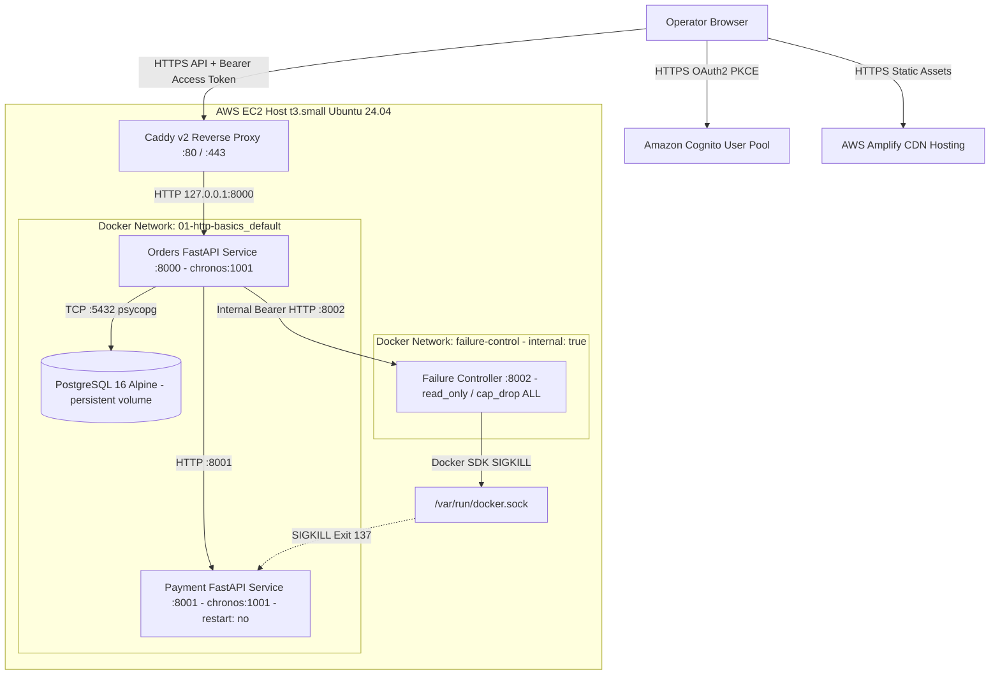
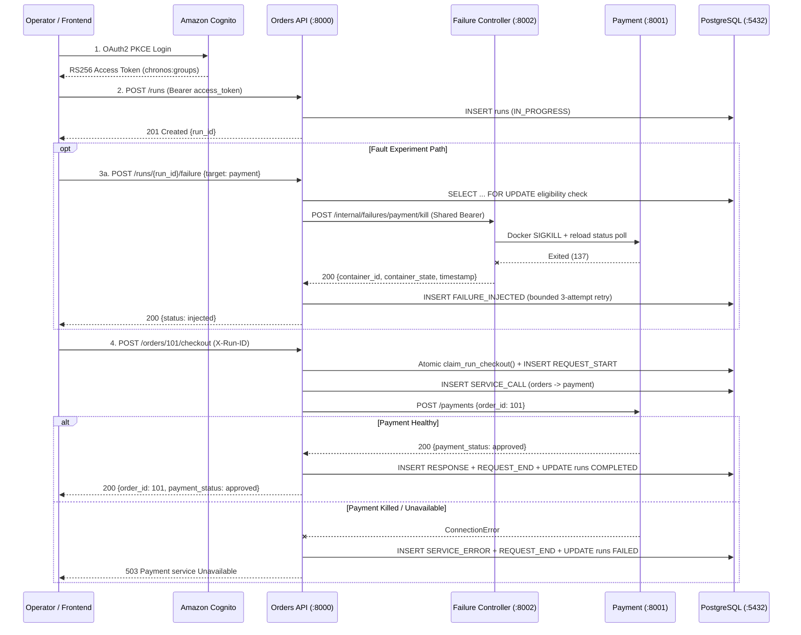

# CHRONOS — Technical Engineering Report

**Project Title:** CHRONOS: Distributed System Observability and Controlled Failure-Experiment Platform  
**Report Date:** November 12, 2026  
**Target Submission Date:** November 13, 2026  
**Repository:** `github.com/sirbasil/chronos` (branch `main`)  
**Production Backend:** `https://chronos-mvp.duckdns.org` (AWS EC2 `ap-south-1`, Caddy TLS)  
**Production Frontend:** `https://main.d2d2s69fek5544.amplifyapp.com/` (AWS Amplify)

---

## 1. Project Overview

**CHRONOS** is an instrumented multi-service observability and controlled failure-experiment platform designed for distributed systems education, architectural demonstration, and fault-isolation verification. The platform operates an Order-to-Payment HTTP microservice workflow backed by PostgreSQL persistence, exposes canonical event telemetry and reconstructed service topology over authenticated REST endpoints, delegates controlled container termination (`SIGKILL` on Payment) through an internal network-isolated Failure Controller sidecar, and presents real-time or offline-simulated run traces through a custom Bertone-inspired digital instrumentation web console.

---

## 2. Abstract

Diagnosing partial failures across distributed microservices is difficult because logs, health checks, topology metadata, and fault triggers frequently live in disjoint subsystems. CHRONOS unifies these capabilities inside a minimal, verifiable four-container architecture (`orders`, `payment`, `failure-controller`, and `postgres`) paired with a React/TypeScript frontend and Amazon Cognito OAuth2 PKCE security. Every experiment run receives a unique server-generated `UUID` (`run_id`) that correlates six canonical telemetry event classes (`REQUEST_START`, `SERVICE_CALL`, `RESPONSE`, `SERVICE_ERROR`, `FAILURE_INJECTED`, and `REQUEST_END`) in PostgreSQL `JSONB` storage. Verification on November 12, 2026 established **132 passing backend pytest tests**, **10 passing frontend unit tests**, a clean TypeScript + Vite production build, hardened non-root (`uid=1001`) OCI containers with patched `zlib1g` libraries, and successful live AWS EC2 production deployment (`2026-11-12T10:50:51Z`) with zero-downtime PostgreSQL preservation and end-to-end fault/recovery validation. Sixteen non-actionable `glibc` CVEs deferred upstream in Debian 13 (`trixie`) remain documented as residual risks alongside honest operational boundaries for interactive Cognito login and single-target recovery.

---

## 3. Problem Statement

When a user request traverses multiple network and process boundaries (browser -> API gateway -> orchestrator -> downstream dependency -> relational database), an outage in a downstream service manifests as elevated error rates or timeouts at the ingress without explaining causality. Developers and students investigating a distributed failure struggle to determine cleanly:

1. Which microservices participated in a given request run and in what directed call order.
2. Whether a downstream failure was triggered prior to request arrival or mid-flight during service invocation.
3. How the exact chronological sequence of telemetry events maps to final run state (`COMPLETED` vs. `FAILED`).
4. How to intentionally break a single container dependency in a reproducible experiment without granting the internet-facing API container unconstrained root-equivalent control over the host Docker daemon.

---

## 4. Motivation

Existing production observability tools (Prometheus, Grafana, Jaeger) and chaos engineering suites (Chaos Mesh, Gremlin) solve enterprise-scale problems at the cost of substantial operational complexity, high memory footprints, and heavy Kubernetes dependencies. Conversely, toy single-file demos omit database persistence, correlation guarantees, concurrency safety, authentication, and container privilege boundaries. CHRONOS bridges this gap by building a disciplined, fully tested, security-hardened MVP where every abstraction—normalized event schema, atomic DB claim locks, derived DAG topology, RBAC token claims, and internal-network sidecar control—is explicit and auditable end to end.

---

## 5. Objectives

| Objective Category | Target Outcome | Verification Status |
|---|---|---|
| **Observability** | Capture canonical UTC-ordered events per `run_id` and derive service topology dynamically via REST. | Verified locally & in EC2 production |
| **Causal Experimentation** | Provide deterministic `SIGKILL` fault injection against `payment` guarded by RBAC, feature flag, single-flight lock, and allowlists. | Verified locally & in EC2 production |
| **Replayable Audit** | Persist all runs and events in PostgreSQL for post-mortem browsing, timeline scrubbing, zoom inspection, and historical listing. | Verified locally & in EC2 production |
| **Zero-Trust Hardening** | Isolate Docker socket access from Orders, authenticate public calls via Cognito RS256 JWKS (`token_use == "access"`), and run containers as non-root `chronos` (`1001`). | Implemented & verified on EC2 (`401`, CORS, `id`) |
| **Reproducible Delivery** | Ship tested containers via ECR to EC2 behind Let's Encrypt HTTPS and Amplify CDN with verified S3 `pg_dump` backups. | Verified on EC2 & S3 (`2026-11-12`) |

---

## 6. Requirements

### 6.1 Functional Requirements

- **FR1 — Health & Readiness Reporting:** `GET /health` must report database connectivity (`connected`/`disconnected`) and Payment reachability (`healthy`/`unreachable`).
- **FR2 — Explicit & Implicit Run Lifecycle:** `POST /runs` generates a server-side UUIDv4 in `IN_PROGRESS` status; `POST /orders/{order_id}/checkout` accepts optional `X-Run-ID` or creates an `IN_PROGRESS` run automatically, transitioning atomically to `COMPLETED` or `FAILED`.
- **FR3 — Duplicate Execution Guard:** A given `run_id` must execute checkout at most once; duplicate or non-`IN_PROGRESS` claims return `HTTP 409 Conflict`.
- **FR4 — Chronological Event & Derived Topology APIs:** `GET /runs/{run_id}/events` returns chronologically sorted `ChronosEvent` records; `GET /runs/{run_id}/topology` returns deduplicated nodes and directed `SERVICE_CALL` edges.
- **FR5 — Controlled Payment Fault Injection:** `POST /runs/{run_id}/failure` accepts `{"target": "payment"}` from authorized operators/admins, kills only the target project's running `payment` container, confirms termination, and records `FAILURE_INJECTED`.
- **FR6 — Dual-Mode Telemetry UI:** React frontend must support both live authenticated API polling (`LIVE MODE`) and clearly badged offline demonstration datasets (`PREVIEW`).

### 6.2 Non-Functional Requirements

- **NFR1 — Fail-Closed Security:** Missing/invalid JWTs return `HTTP 401`; non-operator/admin callers hitting failure injection receive `HTTP 403`; wildcard `*` CORS origins are disallowed; production startup halts if Cognito config or internal controller secret is absent.
- **NFR2 — Container Hardening:** Service images execute as non-root `uid=1001`, patch available Debian security advisories (`zlib1g`), and confine Docker socket mount to a `read_only`, `cap_drop: ALL`, `no-new-privileges` internal sidecar.
- **NFR3 — Data Integrity & Backup Safety:** Container deployments recreate application services cleanly via `--no-deps` without restarting or altering PostgreSQL volumes, gated behind verified S3 backups.

---

## 7. System Architecture

CHRONOS uses a three-tier web + microservice topology in AWS `ap-south-1`:

---

## 8. Component Architecture

| Component | Implementation Artifact | Key Responsibilities & Constraints |
|---|---|---|
| **Web Console** | `frontend/src/` (React 18, TypeScript, Vite) | Cognito PKCE auth gate, Monitor trace lane (`PRE` + `orders` + `payment` + `postgres`), React Flow topology viewer, Service Matrix, JSONB Inspector, offline Preview fixtures. |
| **Orders Service** | `backend/server_fastapi.py`, `auth.py`, `database.py`, `failure_injector.py` | Ingress API behind Caddy (`127.0.0.1:8000`); RS256 JWKS authentication; run/checkout locking; synchronous HTTP calls to Payment (`timeout=3s`); event emission & topology builder. Has **zero** Docker SDK dependency or socket access. |
| **Payment Service** | `backend/payment_service.py` | Minimal FastAPI microservice (`15` Python packages) exposing `GET /health` and `POST /payments`. Configured with `restart: "no"` in Compose so `SIGKILL` holds deterministically until operator restart. |
| **Failure Controller** | `backend/failure_controller/main.py` | Dedicated FastAPI agent on `internal: true` network; constant-time Bearer token comparison (`hmac.compare_digest`); filters containers strictly by Compose project + `payment` label; polls post-kill state up to `10` checks (`50ms` interval). Zero PostgreSQL access. |
| **Database** | `postgres:16-alpine` + `database.py` | Stores `runs` and `events` tables in named volume `01-http-basics_postgres_data`; exposes no public host port in `compose.prod.yml`. |

---

## 9. Detailed Data Flow

---

## 10. Event Schema

All telemetry conforms strictly to the Pydantic model `ChronosEvent` defined in `backend/event_schema.py`:

| Field | Type | Default / Constraint | Purpose |
|---|---|---|---|
| `event_id` | `UUID` | `uuid4()` | Primary key and unique identifier per emitted event |
| `run_id` | `UUID` | Required (FK `runs.run_id`) | Experiment correlation identifier |
| `timestamp` | `datetime` | `datetime.now(timezone.utc)` | UTC timestamp (for `FAILURE_INJECTED`, parsed from Failure Controller timestamp) |
| `service_id` | `str` | Required (`"orders"`, etc.) | Logical emitting service identifier |
| `trace_id` | `str \| None` | `None` | Optional distributed trace correlation string |
| `event_type` | `Literal[...]` | Restricted to 6 canonical values | `REQUEST_START`, `REQUEST_END`, `SERVICE_CALL`, `SERVICE_ERROR`, `RESPONSE`, `FAILURE_INJECTED` |
| `source` | `str` | Required (`"orders-api"`, `"chronos-control"`) | Subcomponent source label |
| `payload` | `dict[str, Any]` | `{}` (stored as `JSONB`) | Event metadata (`order_id`, `destination_service`, `error_type`, `container_id`, `container_state`, etc.) |
| `severity` | `Literal[...]` | `"INFO"`, `"WARNING"`, `"ERROR"` | Event classification for timeline filtering and rendering |

---

## 11. Run Lifecycle

Runs follow a strict deterministic state machine managed inside PostgreSQL transactions:

1. **Creation (`POST /runs`):** Inserts a row in `runs` with `status = 'IN_PROGRESS'` and UTC `started_at`.
2. **Checkout Claim (`claim_run_checkout` / `create_run_and_claim_checkout`):** When `X-Run-ID` is supplied to `POST /orders/{order_id}/checkout`, Orders opens a short transaction (`SELECT ... FOR UPDATE` on `runs`), checks that the run exists (`404`), is still `IN_PROGRESS` (`409`), and has not already emitted `REQUEST_START` (`409`), inserts `REQUEST_START`, and **commits immediately before issuing the downstream HTTP call to Payment**. If `X-Run-ID` is omitted, a new run is created and claimed atomically.
3. **Finalization (`finally:` block in `server_fastapi.py`):** Regardless of checkout outcome (`COMPLETED` or `FAILED`), Orders persists `REQUEST_END` (severity `INFO` or `ERROR`) and updates `runs.status` and `runs.completed_at` inside isolated `try/except` guards so secondary logging errors never hide upstream fault responses.

---

## 12. Order and Payment Workflow

Orders (`backend/server_fastapi.py`) maintains an in-memory catalog (`orders_db` with sample items `101: Keyboard` and `205: Mouse`). During `POST /orders/{order_id}/checkout`:

- Checks `is_failure_injection_in_progress(x_run_id)` first (`409 Conflict` if an active failure injection holds the run).
- Atomically claims the run and emits `REQUEST_START`.
- Returns `404` if `order_id` is absent from `orders_db`.
- Persists `SERVICE_CALL` (`destination_service: "payment"`), then invokes `POST {PAYMENT_SERVICE_URL}/payments` with a `3s` timeout.
- Maps downstream faults deterministically while emitting best-effort `SERVICE_ERROR` events:
  - `Timeout` -> `HTTP 504` (`Payment service timed out`)
  - `ConnectionError` -> `HTTP 503` (`Payment service Unavailable`)
  - `HTTPError`, malformed JSON, or unexpected payload structure -> `HTTP 502`
- On `HTTP 200` with valid `payment_status`/`status`, emits `RESPONSE` (`status_code: 200`), transitions `run_status = "COMPLETED"`, and returns the JSON payload with response header `X-Run-ID`.

---

## 13. Failure Injection Design

CHRONOS resolves the classic "Docker socket mounted into public API" vulnerability by delegating fault execution across three security layers (`backend/failure_injector.py` and `backend/failure_controller/main.py`):

1. **Orders-Side Guards (`failure_injector.py`):**
   - Verifies `ENABLE_FAILURE_INJECTION` is truthy (`403` otherwise).
   - Restricts `target` strictly against `ALLOWED_TARGETS = {"payment": ...}` (`400` otherwise).
   - Acquires in-process per-run lock (`_active_injection_runs`) to reject concurrent injection attempts (`409`).
   - Executes row-locked `verify_failure_injection_permitted(run_id)` in PostgreSQL, failing closed (`HTTP 503`) if the database query errors and rejecting `NOT_FOUND` (`404`), `NOT_IN_PROGRESS` (`409`), `ALREADY_INJECTED` (`409`), or `CHECKOUT_ALREADY_STARTED` (`409`).
2. **Internal Network Transport:** Sends `POST http://failure-controller:8002/internal/failures/payment/kill` across `01-http-basics-failure-control` (`internal: true`) authenticated with `FAILURE_CONTROLLER_TOKEN`.
3. **Failure Controller Execution (`failure_controller/main.py`):**
   - Validates Bearer / header secret using `hmac.compare_digest` (`401` on mismatch; startup fails closed if unconfigured).
   - Queries Docker daemon strictly with labels `com.docker.compose.project={COMPOSE_PROJECT_NAME}` and `com.docker.compose.service=payment`.
   - Rejects missing (`404`), ambiguous (`>1`, `409`), mismatched labels (`502`), prohibited service names `orders`/`postgres` (`400`), or non-running state (`409`).
   - Sends `container.kill()` (`SIGKILL`), then polls `_verify_container_stopped()` up to `10` times (`0.05s` interval) to confirm exit before returning UTC kill timestamp and container state.
4. **Resilient Event Persistence:** Orders parses the controller's UTC timestamp (`_parse_controller_timestamp`) and saves `FAILURE_INJECTED` with `3` bounded retry attempts (`50ms`, `100ms` backoff).

---

## 14. Failure Detection and Recovery

- **Proactive Health Visibility:** `GET /health` probes PostgreSQL (`SELECT 1`) and `GET {PAYMENT_SERVICE_URL}/health` (`timeout=0.5s`). While Payment is stopped, `/health` still responds `HTTP 200` with `{"status": "ok", "database": "connected", "payment": "unreachable"}` so the frontend Service Matrix accurately reflects degraded downstream health.
- **Deterministic Post-Kill Persistence:** Because `payment` uses `restart: "no"` in both `backend/docker-compose.yml` and production Compose, Docker does not auto-resurrect `payment` in a race against the next checkout.
- **Manual Recovery Model:** Recovery is intentionally explicit (`docker compose start payment` on local dev or via AWS SSM in production). Once Payment passes its `/health` check (`interval: 5s`), `orders` resumes `200 OK` checkouts cleanly and `/health` flips back to `"payment": "healthy"`.

---

## 15. Database and Persistence

- **Engine:** `postgres:16-alpine` with `psycopg` (`dict_row` row factory) and `Jsonb` adapter (`backend/database.py`).
- **Schema:**
  - `runs(run_id UUID PRIMARY KEY, started_at TIMESTAMPTZ NOT NULL, completed_at TIMESTAMPTZ, status VARCHAR(50) NOT NULL)`
  - `events(event_id UUID PRIMARY KEY, run_id UUID NOT NULL REFERENCES runs(run_id) ON DELETE CASCADE, timestamp TIMESTAMPTZ NOT NULL, service_id VARCHAR(100) NOT NULL, trace_id VARCHAR(100), event_type VARCHAR(100) NOT NULL, source VARCHAR(100) NOT NULL, payload JSONB NOT NULL DEFAULT '{}'::jsonb, severity VARCHAR(50) NOT NULL)`
  - Indexes: `idx_events_run_id`, `idx_events_timestamp`, `idx_events_run_id_timestamp`.
- **Production Backup Verification (Phase A2, `2026-11-12T10:49:46Z`):**
  - Executed `pg_dump -U chronos -d chronos -F c -b` (exit code `0`) -> `chronos_postgres_20261112_104946Z.dump` (`4,221` bytes, `pg_restore --list` verified `25` TOC lines).
  - Generated SHA256 `fad35d8081770a68c4e36eab37f9b14a8f1ffb0bfa703231eebccc2dc4f2dacc`, uploaded `.dump` and `.dump.sha256` to `s3://chronos-backups-519725697841-ap-south-1-an/postgres/2026/11/`, and verified checksum parity via S3 round-trip download.

---

## 16. Authentication and Authorization

| Mechanism | Details |
|---|---|
| **Identity Provider** | Amazon Cognito User Pool (`ap-south-1_tDVeeHq0g`, App Client `4268fo6vpodgv8dt37tim2aec3`), public client, self-signup disabled. |
| **Frontend OAuth Flow** | AWS Amplify v6 (`aws-amplify@6.22.2`) OAuth2 Authorization Code Grant with PKCE (`openid`, `email`, `profile`) and Hub auth state machine (`LOADING`, `AUTHENTICATED`, `UNAUTHENTICATED`, `CONFIG_ERROR`). |
| **Token Enforcement (`backend/auth.py`)** | Fetches Cognito JWKS (`/.well-known/jwks.json`, 1h thread-safe cache + on-demand `kid` rotation refresh), verifies `RS256` signature, `iss`, `exp`, `nbf`, `sub`, `client_id`, and rejects ID tokens (`token_use != "access"`). |
| **RBAC Matrix** | Public: `/`, `/health`. Authenticated user: `/orders*`, `/runs`, `/runs/{id}*`. Operator/Admin only (`chronos-admins` or `chronos-operators` in `cognito:groups`): `POST /runs/{run_id}/failure` (`HTTP 403` otherwise). |
| **CORS Protection** | Explicit allowlist from `CORS_ALLOWED_ORIGINS` (production: `https://main.d2d2s69fek5544.amplifyapp.com`); wildcard `*` automatically filtered; `allow_credentials=False`. |

---

## 17. Security Measures

- **Edge & Administrative Isolation:** EC2 Security Group `sg-03edd976c4e315db4` permits only TCP `80` and `443` publicly; SSH port `22` is closed in favor of **AWS SSM Session Manager**.
- **Internal Port Restriction:** Orders binds strictly to `127.0.0.1:8000` (proxied by Caddy TLS); Payment (`8001`), Failure Controller (`8002`), and PostgreSQL (`5432`) expose zero public ports in production Compose.
- **Container Hardening:** All three application images execute as non-root `chronos` (`uid=1001`, `gid=1001`); `failure-controller` additionally enables `read_only: true`, `tmpfs` (`noexec,nosuid,size=32m`), `no-new-privileges:true`, `cap_drop: [ALL]`, and `group_add: ["${DOCKER_GID}"]`.
- **Credential Hygiene:** Secrets stay exclusively in EC2 `/opt/chronos/config/.env` (`chmod 600`) and untracked local `.env` files excluded by `.gitignore`.

---

## 18. Deployment Architecture

Production infrastructure runs in `ap-south-1` (AWS Account `519725697841`):

- **Frontend:** AWS Amplify app `d2d2s69fek5544` serving commit `3cd42d143fa864ec7824340d898026642f1f00b4` at `https://main.d2d2s69fek5544.amplifyapp.com/`.
- **Compute & Edge:** EC2 `i-04fa58b2029d481a3` (`t3.small`, Ubuntu `24.04.5 LTS`, Elastic IP `13.205.217.77`) running **Caddy v2** (`chronos-mvp.duckdns.org` with valid Let's Encrypt certificate -> `127.0.0.1:8000`).
- **Deployed Hardened OCI Images (`2026-11-12T10:50:51Z`):**
  - `chronos-orders:mvp-2026-11-12-3cd42d1-securityfix1` (`sha256:94f39aaef93c718227f5ccc6b030af99878a7dd50dd8c75ba4e774b826ae0b42`)
  - `chronos-payment:mvp-2026-11-12-3cd42d1-securityfix1` (`sha256:9707ea97008003223149183675a64c9497d909f00a5d437c957dcf6b8f9e52c8`)
  - `chronos-failure-controller:mvp-2026-11-12-3cd42d1-securityfix1` (`sha256:fabd181723f6bd6878df675f2db3ac25f3faaf55fa89bdd365cf48ffb94a87b4`)
- **Database Preservation:** `01-http-basics-postgres-1` (`postgres:16-alpine`) remained completely untouched during the rollout (`StartedAt` unchanged since `2026-11-08T17:34:06.667480098Z`), with Compose pre-deploy snapshot `/opt/chronos/config/compose.prod.yml.20261112_104946Z.bak` (`SHA256: 3cd3c67bd9fcef2bffaceaf0e0df60eeffb2821c229fcc3c7d99e81627b43a10`) and rollback `mvp-2026-11-08` / `scanfix1` images preserved.

---

## 19. Testing Methodology

Verification combines three layers:

1. **Automated Unit & Integration Suite:** `pytest` exercising `ChronosEvent` validation, Cognito RS256/JWKS/RBAC rejection paths, Postgres atomic checkout claim concurrency, Failure Controller Docker mock/label safety checks, Orders fault handling, and derived topology deduplication; plus Node.js `node:test` verifying frontend UTC delta calculation, scope guards, React Flow layout bounds, and navigation rules.
2. **Local Multi-Container Docker Compose E2E:** Live local containers testing real TCP/HTTP failures, real `SIGKILL` container termination, and Compose recovery.
3. **Production Deployment & Controlled EC2 Smoke Verification:** Pre/post-deploy backup verification, image digest verification, public TLS ingress tests, fail-closed `401`/CORS/JWKS checks, and controlled in-container production handler E2E execution across live `orders`, `payment`, `failure-controller`, and `postgres` containers.

---

## 20. Actual Testing Results

### 20.1 Locally Verified Functionality (`2026-11-12`)

- **Backend Automated Suite:** `cd backend && .venv/bin/pytest -v` -> **`132 passed, 0 failed, 1 warning`** (Starlette `httpx2` deprecation warning) in `14.34s`.
- **Frontend TypeScript & Build:** `cd frontend && npm run build` (`tsc && vite build`) -> **0 errors**, production bundle built in `5.32s`.
- **Frontend Automated Unit Tests:** Compiled `frontend/tests/runTelemetry.test.ts` executed via `node --test` on Node `v20.20.2` -> **`10 passed, 0 failed`**.
- **Local Container E2E:** Verified against `chronos_test` DB with live `securityfix1` local Compose containers (normal run `COMPLETED`, `SIGKILL` `ExitCode=137` + `503` `FAILED`, manual `docker compose start payment` recovery -> `COMPLETED`).

### 20.2 Production Verified Functionality (`2026-11-12`, EC2 `i-04fa58b2029d481a3`)

- **Container Hardening Inside Live Production Containers:** Orders, Payment, and Failure Controller report `uid=1001(chronos) gid=1001(chronos)` and `zlib1g=1:1.3.dfsg+really1.3.1-1+deb13u1`.
- **Public HTTPS & Security Controls (`https://chronos-mvp.duckdns.org`):**
  - `GET /` -> `HTTP 200` (`{"message":"Hello from CHRONOS"}`); `GET /health` -> `HTTP 200` (`{"status":"ok","database":"connected","payment":"healthy"}`).
  - Unauthenticated `GET /runs`, `POST /orders/101/checkout`, and `POST /runs/{id}/failure` -> **`HTTP 401`**.
  - `OPTIONS` CORS preflight for `https://main.d2d2s69fek5544.amplifyapp.com` -> `HTTP/2 200` returning matching `access-control-allow-origin`.
  - Live JWKS retrieval from `orders-1` -> `JWKS_KEYS_COUNT=2`.
  - Internal probes from `orders-1`: `payment:8001/health` (`200 OK`) and `failure-controller:8002/health` (`200 OK`). *(Note: `failure-controller` has no Compose `healthcheck` block so Docker reports `Health=none` while HTTP `/health` responds `200 OK`.)*
- **Controlled Production Functional E2E Sequence (Live EC2 Stack):**
  - **Baseline (`run1_id = 537b47f6-130f-4bce-affb-52d10d37fa7a`, `order_id = 101`):** `IN_PROGRESS` -> `COMPLETED`; events `["REQUEST_START", "SERVICE_CALL", "RESPONSE", "REQUEST_END"]`; topology nodes `["orders", "payment"]` and edge `orders -> payment`.
  - **Failure Injection (`run2_id = 3f80dfe5-558b-480d-9c64-89567c217830`, `order_id = 101`):** Controller executed `SIGKILL` (`Status=exited`, `Running=false`, `ExitCode=137`, `Restart=no`); `/health` reported `payment: "unreachable"`; checkout failed with `HTTP 503` (`"Payment service Unavailable"`); final run status `FAILED`; persisted events `["FAILURE_INJECTED", "REQUEST_START", "SERVICE_CALL", "SERVICE_ERROR", "REQUEST_END"]`.
  - **Recovery & Post-Recovery (`run3_id = de75c365-e670-49aa-9936-7394d6072934`, `order_id = 205`):** `docker compose start payment` restored healthy state in `7s`; checkout returned `HTTP 200` (`approved`), `COMPLETED`; all services returned healthy; DB counts rose cleanly (`runs: 4 -> 7`, `events: 0 -> 13`).

### 20.3 Explicitly Unverified / Network-Gated Items

- **Interactive Cognito PKCE Browser Login E2E Against Live EC2:** Because no Cognito user password is stored in AWS Secrets Manager, SSM Parameter Store, or the repository, and because the local workstation's outbound HTTPS requests to `chronos-mvp.duckdns.org` encounter TLS inspection from a corporate/campus Fortinet firewall, live end-to-end browser login from Amplify (`https://main.d2d2s69fek5544.amplifyapp.com/`) -> Cognito Managed Login -> real Cognito user `access_token` API execution could not be executed non-interactively during this release pass. The E2E functional checks inside `orders-1` exercised live FastAPI route handlers with an authenticated operator model (`AuthenticatedUser`) over real Docker networks while live Cognito `401` rejection and JWKS retrieval were verified separately over HTTPS.

### 20.4 Planned vs. Deferred Functionality

- **Planned for Interactive Presentation Verification:** Live PKCE sign-in using owner's Cognito credentials from an uninspected browser network (or cellular hotspot).
- **Deferred (Post-MVP / Post-GATE):** Automated UI timeline playback animation (Slice 5 M3), transactional outbox recovery between Docker kill and PostgreSQL write, self-healing Payment restart API, and "Mid" variant tooling (OpenTelemetry, Jaeger, Toxiproxy, NATS, Redis, Go).

---

## 21. Security Remediation Results

Before deployment, AWS ECR Basic Scanning reported **19 CVEs per container image** (`4 HIGH`, `11 MEDIUM`, `4 LOW`) across all three services (`mvp-2026-11-12-3cd42d1-scanfix1`). Remediation under tag `mvp-2026-11-12-3cd42d1-securityfix1` achieved:

| Finding / Metric | Before (`scanfix1`) | After (`securityfix1`) | Verification |
|---|---|---|---|
| `zlib1g:amd64` (`CVE-2026-76844`, `CVE-2026-85091`, `CVE-2026-27171`) | `1:1.3.dfsg+really1.3.1-1+b1` | `1:1.3.dfsg+really1.3.1-1+deb13u1` | **Cleared** from ECR rescans across all 3 images |
| ECR Finding Counts (all 3 repos) | `4 HIGH`, `11 MED`, `4 LOW` | **`2 HIGH`, `10 MED`, `4 LOW`** | `0` newly introduced CVEs |
| Container Runtime Identity | `orders`/`payment`: `root` (`0`); `fc`: `chronos` (`1001`) | **All 3 images: `chronos` (`1001`)** | Verified live via `docker exec ... id` on EC2 |
| Payment Python Surface | `25` packages (`65.72 MB` compressed) | **`15` packages (`49.39 MB`)** via `requirements.payment.txt` | Dropped unused DB/JWT/crypto/HTTP client libs |
| PyPI Advisories (`api.osv.dev`) | Unpinned `PyJWT>=2.9.0` | `pyjwt[crypto]==2.15.1` (`26` unique PyPI pkgs checked) | **`0` OSV advisories** |

**Residual Risk Disclosure — Remaining 16 `glibc` CVEs (`libc6` `2.41-12+deb13u4`):**  
The `2 HIGH` (`CVE-2026-19499` `strfmon`, `CVE-2026-5435` deprecated DNS debug printers), `10 MEDIUM`, and `4 LOW` findings belong strictly to Debian 13 (`trixie`) `libc6`. Fourteen are classified `nodsa: "Minor issue"` by the Debian Security Team (queued for a future Debian point release) and two lack an upstream Debian fix even in `sid`. None of the affected functions (`strfmon`, wide `scanf`, `wordexp`, `tsearch`/`tdelete`, JIS `iconv`, `nscd`, `setuid` `$ORIGIN` `DT_RPATH`, or Power8 `strncasecmp`) are invoked by CHRONOS's pure-Python runtime on `linux/amd64` containers.

---

## 22. Limitations

1. **Non-Atomic Fault & Database Persistence:** `container.kill()` executes externally to PostgreSQL; bounded `3`-attempt retries protect against transient database errors, yet a prolonged PostgreSQL outage immediately after `SIGKILL` could leave `payment` stopped without a persisted `FAILURE_INJECTED` row (no outbox reconciler exists).
2. **Manual Fault Recovery Only:** Recovery requires running `docker compose start payment` rather than calling a self-healing API endpoint.
3. **Single Target & Mock Business Domain:** Failure injection supports only `payment`, and `orders_db` contains two static sample orders (`101`, `205`).
4. **No Automated Animation Playback Control:** Monitor provides chronological inspection, time scrubber, zoom (`0.75X`–`2.5X`), and `PRE` fault bay, omitting autonomous play/pause stepping.
5. **Corporate SSL Inspection Sensitivity:** Evaluation networks employing deep-packet TLS inspection (such as Fortinet SSL proxy) require trusting the proxy root CA or switching networks to avoid browser API failures against `chronos-mvp.duckdns.org`.
6. **Frontend Test Runner Wiring:** `frontend/tests/runTelemetry.test.ts` runs via `tsc` + `node --test` rather than a built-in `"test"` entry in `frontend/package.json`.

---

## 23. Future Enhancements

- Implement a **PostgreSQL transactional outbox** and reconciliation worker guaranteeing eventual consistency between container actions and `FAILURE_INJECTED` telemetry.
- Add **OpenTelemetry trace propagation and Jaeger export** alongside existing `ChronosEvent` storage.
- Integrate **Toxiproxy** and multi-service scenarios (latency injection, HTTP 5xx faults, partial failures) once past the semester gate.
- Expose RBAC-protected **controlled recovery** (`start`/`healthcheck` verification) and **interactive play/pause/step timeline controls** in the UI.
- Rebuild container base images once Debian 13 ships patched `libc6` in a point release.

---

## 24. Conclusion

CHRONOS delivers a cohesive, security-conscious, and thoroughly verified distributed observability MVP. Through a normalized PostgreSQL event contract, row-locked checkout semantics, derived topology reconstruction, network-isolated container fault injection, Cognito RS256 JWKS/RBAC enforcement, and hardened non-root containers (`mvp-2026-11-12-3cd42d1-securityfix1`) running cleanly in AWS `ap-south-1`, the platform demonstrates practical fault causality end to end. All **132** backend tests, **10** frontend tests, security scan fixes, S3 backups, and EC2 production health/fault-injection checks passed verification, with remaining `glibc` advisories and interactive Cognito login verification boundaries documented transparently for submission.
